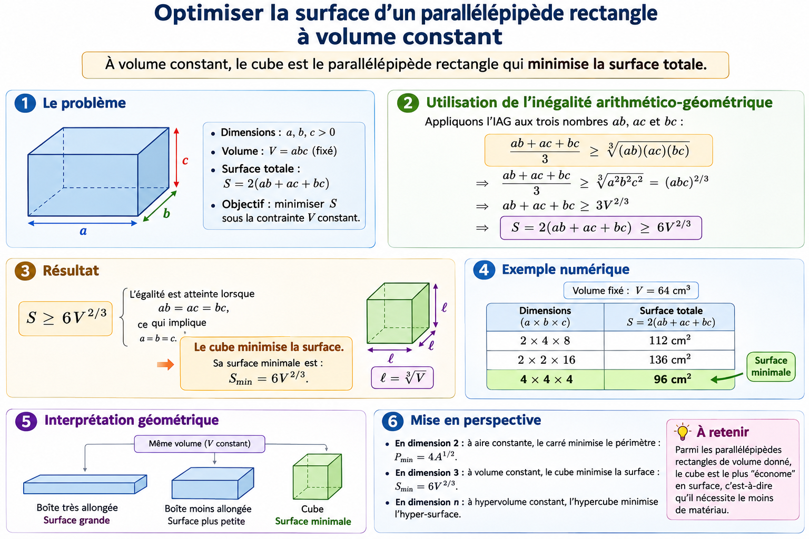

Soit $n \in \mathbb{N}^*$ et $x_1, \dots, x_n$ des réels strictement positifs. On a l'inégalité suivante :
$$ \left( \prod_{i=1}^n x_i \right)^{1/n} \le \frac{1}{n} \sum_{i=1}^n x_i $$
L'égalité a lieu si et seulement si $x_1 = x_2 = \dots = x_n$.

### Méthode 1 : Concavité du logarithme

La fonction $\ln$ est deux fois dérivable sur $]0, +\infty[$ et $\forall x > 0, \ln''(x) = -\frac{1}{x^2} < 0$.
Ainsi, $\ln$ est concave sur $]0, +\infty[$.
Par l'inégalité de Jensen, pour tous $x_1, \dots, x_n > 0$ et des poids $\alpha_i = \frac{1}{n}$, on a :
$$ \ln\left( \frac{1}{n} \sum_{i=1}^n x_i \right) \ge \frac{1}{n} \sum_{i=1}^n \ln(x_i) $$
En utilisant les propriétés du logarithme :
$$ \ln\left( \frac{1}{n} \sum_{i=1}^n x_i \right) \ge \ln\left( \left( \prod_{i=1}^n x_i \right)^{1/n} \right) $$
Par croissance de l'exponentielle, on obtient :
$$ \frac{1}{n} \sum_{i=1}^n x_i \ge \left( \prod_{i=1}^n x_i \right)^{1/n} $$
Le cas d'égalité dans l'inégalité de Jensen pour une fonction strictement concave (ce qui est le cas de $\ln$) impose que tous les $x_i$ soient égaux.

### Illustration avec $n=3$

On retrouve ici un principe fondamental :
- En dimension 2, à aire constante, le carré minimise le périmètre.
- En dimension 3, à volume constant, le cube minimise la surface.
- En dimension \(n\), à hypervolume constant, l'hypercube minimise la mesure de son hyper-surface.

Il faut toutefois distinguer cette propriété des résultats plus généraux de géométrie : parmi toutes les formes de l'espace de volume donné, c'est la sphère qui minimise la surface. Le cube n'est optimal que dans la famille des parallélépipèdes rectangles.

### Méthode 2 : Récurrence de Cauchy (Récurrence "avant-arrière")

Soit $P(n)$ la propriété : $\forall x_1, \dots, x_n > 0, \left( \prod_{i=1}^n x_i \right)^{1/n} \le \frac{1}{n} \sum_{i=1}^n x_i$.

**Initialisation** : $P(1)$ et $P(2)$ sont triviales. Pour $n=2$, $(\sqrt{x_1} - \sqrt{x_2})^2 \ge 0 \implies x_1 + x_2 - 2\sqrt{x_1x_2} \ge 0 \implies \sqrt{x_1x_2} \le \frac{x_1+x_2}{2}$.

**Hérédité (Pas en avant)** : Montrons que $P(n) \implies P(2n)$.
Soient $x_1, \dots, x_{2n} > 0$.
$$ \frac{x_1 + \dots + x_{2n}}{2n} = \frac{\frac{x_1 + \dots + x_n}{n} + \frac{x_{n+1} + \dots + x_{2n}}{n}}{2} $$
Par $P(n)$ appliqué aux deux blocs de $n$ variables :
$$ \frac{x_1 + \dots + x_{2n}}{2n} \ge \frac{(x_1 \dots x_n)^{1/n} + (x_{n+1} \dots x_{2n})^{1/n}}{2} $$
Par $P(2)$ appliqué à ces deux moyennes géométriques :
$$ \frac{x_1 + \dots + x_{2n}}{2n} \ge \sqrt{(x_1 \dots x_n)^{1/n} (x_{n+1} \dots x_{2n})^{1/n}} = (x_1 \dots x_{2n})^{1/2n} $$
Par récurrence, $P(2^k)$ est vraie pour tout $k \in \mathbb{N}$.

**Régression (Pas en arrière)** : Montrons que $P(n) \implies P(n-1)$.
Soient $x_1, \dots, x_{n-1} > 0$. Posons $x_n = \frac{x_1 + \dots + x_{n-1}}{n-1}$ (la moyenne arithmétique des $n-1$ premiers termes).
On applique $P(n)$ à $x_1, \dots, x_n$ :
$$ \frac{x_1 + \dots + x_{n-1} + x_n}{n} \ge (x_1 \dots x_{n-1} x_n)^{1/n} $$
Or $\frac{x_1 + \dots + x_{n-1} + x_n}{n} = \frac{(n-1)x_n + x_n}{n} = x_n$.
D'où $x_n \ge (x_1 \dots x_{n-1} x_n)^{1/n}$.
En élevant à la puissance $n$ : $x_n^n \ge x_1 \dots x_{n-1} x_n \implies x_n^{n-1} \ge x_1 \dots x_{n-1}$.
Soit $x_n \ge (x_1 \dots x_{n-1})^{1/(n-1)}$, ce qui est exactement $P(n-1)$.

### Méthode 3 : Optimisation sous contrainte (Multiplicateurs de Lagrange)

On cherche à maximiser $f(x_1, \dots, x_n) = \prod_{i=1}^n x_i$ sur l'ensemble $K = \{ (x_1, \dots, x_n) \in (\mathbb{R}_+^*)^n \mid \sum_{i=1}^n x_i = S \}$ où $S$ est une constante.
L'ensemble des points admissibles (fermeture de $K$) est compact, et $f$ s'annule sur le bord, donc le maximum est atteint à l'intérieur de $K$.
Soit $g(x_1, \dots, x_n) = \sum_{i=1}^n x_i - S$. On utilise les multiplicateurs de Lagrange : $\nabla f = \lambda \nabla g$.
$$ \forall i \in \{1, \dots, n\}, \frac{\partial f}{\partial x_i} = \prod_{j \ne i} x_j = \frac{f(x)}{x_i} = \lambda \frac{\partial g}{\partial x_i} = \lambda $$
Ainsi, $x_i = \frac{f(x)}{\lambda}$ pour tout $i$. Tous les $x_i$ sont égaux.
Comme $\sum x_i = S$, on a $n x_i = S \implies x_i = \frac{S}{n}$ pour tout $i$.
La valeur maximale de $f$ est donc $(\frac{S}{n})^n$.
Pour tout $x \in K$, $\prod x_i \le (\frac{\sum x_i}{n})^n$, ce qui donne $\left(\prod x_i\right)^{1/n} \le \frac{1}{n} \sum x_i$.
