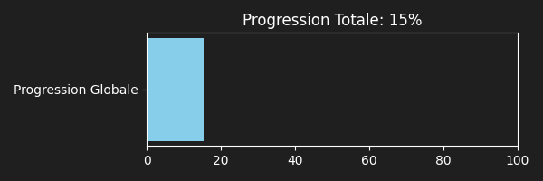
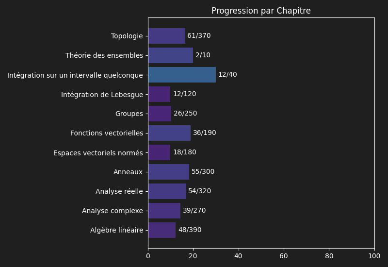

**237** Théorèmes à réviser sur **268** au total

# 📚 Révisions pour le 06/10/2026

**21** Théorèmes

## 1. Caractérisation racine d'un polynôme, lien nombre de racines / degré, degré d'un produit de polynômes

<b>Chapitre</b>

<blockquote>
Anneaux
</blockquote>

<b>Énoncé</b>

---

Soit $A$ un anneau commutatif et $P \in A[X]$. Alors $a \in A$ est racine de $P$ si et seulement si $(X - a) \mid P$ dans $A[X]$.

Si $A$ est intègre, alors le nombre de racines distinctes de $P$ dans $A$ est inférieur ou égal au degré de $P$.

$\forall P, Q \in A[X]$, $\deg(PQ) \le \deg(P) + \deg(Q)$.

Si $A$ est intègre, alors $\deg(PQ) = \deg(P) + \deg(Q)$.

---

## 2. Endomorphismes cycliques

<b>Chapitre</b>

<blockquote>
Algèbre linéaire
</blockquote>

<b>Énoncé</b>

---

Un endomorphisme $u \in \mathcal{L}(E)$ est dit **cyclique** ssi $\exists x \in E$ tel que $(x, u(x), u^2(x), \dots, u^{n-1}(x))$ forme une base de $E$.

$$u \text{ est cyclique }$$
$$\iff m_u = \chi_u$$
$$\iff C(u) = \mathbb{K}[u]$$

Si $u$ est diagonalisable, alors $u$ est cyclique $\iff u$ est à valeurs propres simples.

---

## 3. Théorème de Heine-Borel

<b>Chapitre</b>

<blockquote>
Topologie
</blockquote>

<b>Énoncé</b>

---

Soit $(E, d)$ un espace métrique. Alors une partie $A \subseteq E$ est compacte si et seulement si elle est séquentiellement compacte.

Propriété de Borel-Lebesgue $\iff$ Propriété de Bolzano-Weierstrass

---

## 4. Théorème des zéros isolés

<b>Chapitre</b>

<blockquote>
Analyse complexe
</blockquote>

<b>Énoncé</b>

---

Soit $U$ un ouvert connexe de $\mathbb{C}$ et soit $f : U \to \mathbb{C}$ une fonction holomorphe. Si l'ensemble
$$
f^{-1}(\{0\}) = \{z \in U \mid f(z) = 0\}
$$
admet un point d'accumulation dans $U$, alors $f$ est identiquement nulle sur $U$.

---

## 5. Espace métrique séparable

<b>Chapitre</b>

<blockquote>
Topologie
</blockquote>

<b>Énoncé</b>

---

Un espace métrique $(E, d)$ est dit **séparable** s'il existe une partie de $E$ dénombrable dense.

---

## 6. Limite uniforme de fonctions continues

<b>Chapitre</b>

<blockquote>
Fonctions vectorielles
</blockquote>

<b>Énoncé</b>

---

Soit $X$ un espace métrique et $(E, \|\cdot\|)$ un espace vectoriel normé. Soit $(f_n)_{n \in \mathbb{N}}$ une suite de fonctions de $X$ vers $E$. Si chaque fonction $f_n$ est continue sur $X$ et si la suite $(f_n)$ converge uniformément vers une fonction $f : X \to E$, alors $f$ est continue sur $X$.

---

## 7. Propriété de Bolzano-Weierstrass

<b>Chapitre</b>

<blockquote>
Topologie
</blockquote>

<b>Énoncé</b>

---

Soit $(E, d)$ un espace métrique. Alors une partie $A \subseteq E$ est séquentiellement compacte si et seulement si toute suite d'éléments de $A$ admet une sous-suite convergente vers un élément de $A$.

---

## 8. Théorème du prolongement analytique

<b>Chapitre</b>

<blockquote>
Analyse complexe
</blockquote>

<b>Énoncé</b>

---

Soit $U$ un ouvert connexe de $\mathbb{C}$, $z_0 \in U$ et $f : U \to \mathbb{C}$ une fonction analytique.

$$\left[\forall n \in \mathbb{N},\ f^{(n)}(z_0)=0\right] \Longleftrightarrow f \equiv 0.$$

---

## 9. $1^{\text{er}}$ théorème d'isomorphisme pour les anneaux

<b>Chapitre</b>

<blockquote>
Anneaux
</blockquote>

<b>Énoncé</b>

---

Soient $A, B$ deux anneaux et $\varphi : A \to B$ un morphisme d'anneaux.
Alors $\text{Ker}(\varphi)$ est un idéal de $A$, $\text{Im}(\varphi)$ est un sous-anneau de $B$, et $\varphi$ induit un isomorphisme d'anneaux :
$$\bar{\varphi} : A/\text{Ker}(\varphi) \xrightarrow{\sim} \text{Im}(\varphi)$$

---

## 10. Décomposition de Dunford

<b>Chapitre</b>

<blockquote>
Algèbre linéaire
</blockquote>

<b>Énoncé</b>

---

Soit $E$ un espace vectoriel de dimension finie sur $\mathbb{K}$. Soit $u \in \mathcal{L}(E)$ un endomorphisme dont le polynôme caractéristique est scindé sur $\mathbb{K}$.
Alors il existe un unique couple $(d, n) \in \mathcal{L}(E)^2$ tel que :

1. $u = d + n$
2. $d$ est diagonalisable et $n$ est nilpotent
3. $d$ et $n$ commutent ($d \circ n = n \circ d$)

De plus, $d$ et $n$ sont des polynômes en $u$.

---

## 11. Théorème spectral

<b>Chapitre</b>

<blockquote>
Algèbre linéaire
</blockquote>

<b>Énoncé</b>

---

Soit $E$ un espace euclidien (espace vectoriel réel muni d'un produit scalaire). Soit $u \in \mathcal{L}(E)$ un endomorphisme symétrique.

Alors il existe une base orthonormée de $E$ composée de vecteurs propres de $u$. En particulier, $u$ est diagonalisable.

Version matricielle :
Soit $A \in \mathcal{M}_n(\mathbb{R})$ une matrice symétrique. Alors il existe $P \in \mathcal{O}_n(\mathbb{R}), D \in \mathcal{D}_n(\mathbb{R})$ telles que :
$$ A = P^T D P$$

---

## 12. Convergence simple d'une suite de fonctions

<b>Chapitre</b>

<blockquote>
Fonctions vectorielles
</blockquote>

<b>Énoncé</b>

---

Soit $X$ un ensemble et $(E, \|\cdot\|)$ un espace vectoriel normé. Soit $(f_n)_{n \in \mathbb{N}}$ une suite de fonctions de $X$ vers $E$. On dit que la suite $(f_n)$ converge simplement vers une fonction $f : X \to E$ si :
$$\forall x \in X, f_n(x) \xrightarrow[n \to \infty]{} f(x)$$

---

## 13. Théorème de prolongement d'une fonction uniformément continue

<b>Chapitre</b>

<blockquote>
Topologie
</blockquote>

<b>Énoncé</b>

---

Soit $(E,d)$ et $(F, \delta)$ deux espaces métriques et $A \subseteq E$. On suppose que $F$ est complet. Soit $f : A \to F$ une fonction uniformément continue.

Alors il existe une unique fonction continue $\tilde{f} : \overline{A} \to F$ telle que $\tilde{f}_{|A} = f$. De plus, $\tilde{f}$ est uniformément continue.

---

## 14. Théorème de Borel-Lebesgue

<b>Chapitre</b>

<blockquote>
Topologie
</blockquote>

<b>Énoncé</b>

---

Dans un espace vectoriel normé de dimension finie, les fermés bornés sont compacts.

---

## 15. Propriété de Borel-Lebesgue

<b>Chapitre</b>

<blockquote>
Topologie
</blockquote>

<b>Énoncé</b>

---

Soit $(E,d)$ un espace métrique, $A \subseteq E$. Alors $A$ est compact si et seulement si toute famille d'ouverts de $E$ qui recouvre $A$ admet un sous-recouvrement fini.

Ceci équivaut à : de toute famille de fermés de $E$ dont l'intersection est vide dans $A$, on peut extraire une sous-famille finie dont l'intersection est vide dans $A$.

---

## 16. Théorème de Cayley-Hamilton

<b>Chapitre</b>

<blockquote>
Algèbre linéaire
</blockquote>

<b>Énoncé</b>

---

Soit $E$ un espace vectoriel de dimension finie $n$. Pour tout endomorphisme $u \in \mathcal{L}(E)$, son polynôme caractéristique $\chi_u$ est un polynôme annulateur de $u$ :
$$\chi_u(u) = 0_{\mathcal{L}(E)}$$

---

## 17. Limite uniforme de fonctions bornées

<b>Chapitre</b>

<blockquote>
Fonctions vectorielles
</blockquote>

<b>Énoncé</b>

---

Soit $X$ un ensemble et $(E, \|\cdot\|)$ un espace vectoriel normé. Soit $(f_n)_{n \in \mathbb{N}}$ une suite de fonctions bornées de $X$ vers $E$. Si la suite $(f_n)$ converge uniformément vers une fonction $f : X \to E$, alors $f$ est bornée sur $X$.

---

## 18. Caractérisation des matrices trigonalisables

<b>Chapitre</b>

<blockquote>
Algèbre linéaire
</blockquote>

<b>Énoncé</b>

---

Soit $A \in \mathcal{M}_n(\mathbb{K})$. Les propositions suivantes sont équivalentes :

1. $A$ est trigonalisable sur $\mathbb{K}$.
2. $\chi_A$ est scindé sur $\mathbb{K}$.
3. $\pi_A$ est scindé sur $\mathbb{K}$.

---

## 19. Polynôme

<b>Chapitre</b>

<blockquote>
Anneaux
</blockquote>

<b>Énoncé</b>

---

Soit $A$ un anneau commutatif. L'anneau des polynômes à une indéterminée $X$ à coefficients dans $A$ est l'ensemble :
$$A[X] = \left\{ \sum_{i=0}^n a_i X^i : n \in \mathbb{N}, a_i \in A \right\}$$

---

## 20. Caractérisation des matrices diagonalisables

<b>Chapitre</b>

<blockquote>
Algèbre linéaire
</blockquote>

<b>Énoncé</b>

---

Une matrice $A \in \mathcal{M}_n(\mathbb{K})$ est diagonalisable sur $\mathbb{K}$ si et seulement si l'une des conditions suivantes est vérifiée :

1. $\chi_A$ est scindé (ie. u est scindé) sur $\mathbb{K}$ et la dimension de chaque sous-espace propre est égale à la multiplicité de la valeur propre correspondante.
2. Son polynôme minimal $\pi_A$ est scindé à racines simples sur $\mathbb{K}$.

---

## 21. Commutant d'un endomorphisme

<b>Chapitre</b>

<blockquote>
Algèbre linéaire
</blockquote>

<b>Énoncé</b>

---

Soit $u \in \mathcal{L}(E)$. Le commutant de $u$ est l'ensemble $C(u) = \{v \in \mathcal{L}(E) : u \circ v = v \circ u\}$. C'est une sous-algèbre de $\mathcal{L}(E)$.

Si $u$ est diagonalisable de valeurs propres $\lambda_1, \dots, \lambda_p$ et d'espaces propres associés $E_{\lambda_1}, \dots, E_{\lambda_p}$, alors l'application suivante est un isomorphisme d'algèbres :
$$\varphi : \begin{cases} C(u) \to \mathcal{L}(E_{\lambda_1}) \times \dots \times \mathcal{L}(E_{\lambda_p}) \\ v \mapsto (v_{|E_{\lambda_1}}, \dots, v_{|E_{\lambda_p}}) \end{cases}$$
En particulier, $\dim(C(u)) = \sum\limits_{i=1}^p \dim(E_{\lambda_i})^2$.

Si $u$ est diagonalisable, on a l'équivalence :
$$C(u) = \mathbb{K}[u] \iff u \text{ est à valeurs propres simples}$$
Dans ce cas, $\dim(C(u)) = n$.

Le **bicommutant** de $u$ est $C_2(u) = \{w \in \mathcal{L}(E) : \forall v \in C(u), v \circ w = w \circ v\}$.
On a toujours l'égalité :
$$C_2(u) = \mathbb{K}[u]$$

---

 

# 📚 Révisions pour le 07/10/2026

**43** Théorèmes

## 1. Limite uniforme de fonctions holomorphes

<b>Chapitre</b>

<blockquote>
Analyse complexe
</blockquote>

<b>Énoncé</b>

---

Soit $U$ un ouvert de $\mathbb{C}$ et $(f_n)_{n \in \mathbb{N}}$ une suite de fonctions holomorphes sur $U$. On suppose que $(f_n)$ converge uniformément sur tout compact de $U$ vers une fonction $f : U \to \mathbb{C}$.

Alors $f$ est holomorphe sur $U$ et on a $\forall k \in \mathbb{N}$, $(f_n^{(k)})_{n \in \mathbb{N}}$ converge uniformément sur tout compact de $U$ vers $f^{(k)}$.

---

## 2. Longueur d'un chemin

<b>Chapitre</b>

<blockquote>
Analyse complexe
</blockquote>

<b>Énoncé</b>

---

Soit $U$ un ouvert de $\mathbb{C}$ et $\gamma : [a,b] \to U$ un chemin de classe $C^1$. La longueur du chemin $\gamma$ est définie par :
$$ Long(\gamma) = \int_a^b |\gamma'(t)| \, dt $$

---

## 3. Sous-groupes finis du groupe multiplicatif d'un corps

<b>Chapitre</b>

<blockquote>
Anneaux
</blockquote>

<b>Énoncé</b>

---

Soit $k$ un corps (ou même un anneau intègre) et $G$ un sous-groupe fini de $(k^*, \times)$.
Alors $G$ est cyclique.
En particulier, le groupe des inversibles d'un corps fini est cyclique.

---

## 4. Éléments inversibles d'un anneau

<b>Chapitre</b>

<blockquote>
Anneaux
</blockquote>

<b>Énoncé</b>

---

Un élément $x \in A$ est **inversible** s'il existe $y \in A$ tel que $xy = yx = 1_A$. L'ensemble des éléments inversibles est noté $A^\times$ ou $U(A)$.

---

## 5. Existence d'un élément maximal dans une famille d'idéaux

<b>Chapitre</b>

<blockquote>
Anneaux
</blockquote>

<b>Énoncé</b>

---

Soit $A$ un anneau principal, $K \not ={\emptyset}$. Toute famille d'idéaux \{I_\alpha\}_{\alpha \in K} de $A$ admet un idéal maximal pour l'inclusion.
En particulier, tout idéal propre de $A$ est contenu dans un idéal maximal.

---

## 6. Théorème chinois dans un anneau principal

<b>Chapitre</b>

<blockquote>
Anneaux
</blockquote>

<b>Énoncé</b>

---

Soit $A$ un anneau principal, et $a, b \in A$ deux éléments premiers entre eux (i.e. tels que $\text{pgcd}(a, b) = 1$).
Alors le morphisme naturel
$$ \varphi : A/(ab) \to A/(a) \times A/(b) $$
est un isomorphisme d'anneaux, dont on peut expliciter la réciproque à l'aide d'une relation de Bézout entre $a$ et $b$ : si $au + bv = 1$, l'antécédent de $(\bar{x}, \bar{y}) \in A/(a) \times A/(b)$ par ce morphisme est la classe de $auy + bvx$ dans $A/(ab)$.

Par récurrence, on peut étendre ce résultat à $a_1, \dots, a_n$ deux-à-deux premiers entre eux.

---

## 7. Lemme de Gauss

<b>Chapitre</b>

<blockquote>
Anneaux
</blockquote>

<b>Énoncé</b>

---

Soit $A$ un anneau principal.

Pour tous $a, b, c \in A$, si $a$ divise $bc$ et $\text{pgcd}(a, b) = 1$, alors $a$ divise $c$.

---

## 8. Composition de fonctions convexes

<b>Chapitre</b>

<blockquote>
Analyse réelle
</blockquote>

<b>Énoncé</b>

---

Soient $I$ et $J$ deux intervalles de $\mathbb{R}$. Soit $f : I \to J$ et $g : J \to \mathbb{R}$ deux fonctions.
Si $f$ est convexe, $g$ est convexe et $g$ est croissante, alors $g \circ f$ est convexe sur $I$.

---

## 9. Développement limité du logarithme

<b>Chapitre</b>

<blockquote>
Analyse réelle
</blockquote>

<b>Énoncé</b>

---

Soit $n \in \mathbb{N}^*$. Au voisinage de $0$, on a :
$$ \ln(1+x) = \sum\limits_{k=1}^{n} (-1)^{k-1} \frac{x^k}{k} + O(x^{n+1}) $$

---

## 10. Développement limité de l'exponentielle

<b>Chapitre</b>

<blockquote>
Analyse réelle
</blockquote>

<b>Énoncé</b>

---

Soit $n \in \mathbb{N}$. Au voisinage de $0$, on a :
$$ e^x = \sum\limits_{k=0}^{n} \frac{x^k}{k!} + O(x^{n+1}) $$

---

## 11. Théorème de la double limite

<b>Chapitre</b>

<blockquote>
Fonctions vectorielles
</blockquote>

<b>Énoncé</b>

---

Soit $(E,d)$ un espace métrique et $(F,\delta)$ un espace métrique complet. Soit $a \in \overline{E}$ (avec $a \in \overline{\mathbb{R}}$ si $E = \mathbb{R}$). Soit $(f_n)_{n \in \mathbb{N}}$ une suite de fonctions de $E$ vers $F$.
Supposons que :

1. Pour tout $n \in \mathbb{N}$, $\lim_{x \to a} f_n(x) = \lambda_n$ existe dans $F$.
2. La suite $(f_n)$ converge uniformément vers une fonction $f : E \to F$.

Alors :

- La suite $(\lambda_n)_{n \in \mathbb{N}}$ converge vers une limite $\lambda \in F$.
- La fonction $f$ admet une limite en $a$ qui est égale à $\lambda$.

On a alors l'égalité : $\lim_{n \to \infty} \lim_{x \to a} f_n(x) = \lim_{x \to a} \lim_{n \to \infty} f_n(x)$.

---

## 12. Intégrale d'une fonction continue selon un chemin $C^1_pm$

<b>Chapitre</b>

<blockquote>
Analyse complexe
</blockquote>

<b>Énoncé</b>

---

Soit $U$ un ouvert de $\mathbb{C}$ et $\gamma : [a,b] \to U$ un chemin de classe $C^1$ par morceaux. Soit $f : U \to \mathbb{C}$ une fonction continue. On définit l'intégrale de $f$ selon $\gamma$ par :
$$ \int_{\gamma} f(z) \, dz = \int_a^b f(\gamma(t)) \cdot \gamma'(t) \, dt $$

---

## 13. Indice d'un lacet

<b>Chapitre</b>

<blockquote>
Analyse complexe
</blockquote>

<b>Énoncé</b>

---

Soit $\gamma : [a,b] \to \mathbb{C}$ un lacet de classe $C^1_pm$. Pour tout point $z \in \mathbb{C} \setminus \text{Im}(\gamma)$, on définit l'indice de $\gamma$ par rapport à $z$ par :
$$ \text{ind}_{\gamma}(z) = \frac{1}{2i\pi} \int_{\gamma} \frac{dw}{w-z} $$
L'application $\text{ind}_{\gamma} : \mathbb{C} \setminus \text{Im}(\gamma) \to \mathbb{C}$ est continue et à valeurs dans $\mathbb{Z}$.

---

## 14. Théorème de dérivation d'une intégrale à paramètre

<b>Chapitre</b>

<blockquote>
Intégration sur un intervalle quelconque
</blockquote>

<b>Énoncé</b>

---

Soit $X$ et $I$ deux intervalles de $\mathbb{R}$. Soit $f : X \times I \to \mathbb{C}$ telle que :

1. Pour tout $x \in X$, la fonction $t \mapsto f(x, t)$ est continue par morceaux et intégrable sur $I$.
2. La fonction $f$ admet une dérivée partielle selon $x$, notée $\frac{\partial f}{\partial x}$, telle que :
   - Pour tout $x \in X$, $t \mapsto \frac{\partial f}{\partial x}(x, t)$ est continue par morceaux sur $I$.
   - Pour tout $t \in I$, $x \mapsto \frac{\partial f}{\partial x}(x, t)$ est continue sur $X$.
3. Il existe $\varphi \in \mathcal{C}_{m}(I, \mathbb{R}^+)$ intégrable sur $I$ telle que pour tout $(x, t) \in X \times I$, $|\frac{\partial f}{\partial x}(x, t)| \le \varphi(t)$ (hypothèse de domination).

Alors $F : x \mapsto \int_I f(x, t) dt$ est de classe $\mathcal{C}^1$ sur $X$ et :
$$F'(x) = \int_I \frac{\partial f}{\partial x}(x, t) dt$$

---

## 15. Existence et unicité du développement en série de Laurent

<b>Chapitre</b>

<blockquote>
Analyse complexe
</blockquote>

<b>Énoncé</b>

---

Soit $f$ holomorphe sur un anneau $A(z_0, r, R)$. Alors $f$ admet un unique développement en série de Laurent : il existe une unique suite $(a_n)_{n \in \mathbb{Z}}$ telle que
$$\forall z \in A(z_0, r, R), \quad f(z) = \sum\limits_{n = -\infty}^{+\infty} a_n (z - z_0)^n$$
De plus, les coefficients sont donnés par :
$$\forall n \in \mathbb{Z}, \quad a_n = \frac{1}{2i\pi} \int_{\mathcal{C}(z_0, r')} \frac{f(w)}{(w - z_0)^{n+1}} dw$$
pour n'importe quel $r' \in ]r, R[$, où $\mathcal{C}(z_0, r')$ est le cercle de centre $z_0$ et de rayon $r'$ orienté positivement.

---

## 16. Classification des singularités

<b>Chapitre</b>

<blockquote>
Analyse complexe
</blockquote>

<b>Énoncé</b>

---

Soit $U$ un ouvert de $\mathbb{C}$, $z_0 \in U$ et $f : U \setminus \{z_0\} \to \mathbb{C}$ une fonction holomorphe. Seuls 3 cas sont possibles :

1. $f$ admet un prolongement holomorphe sur $U$. Dans ce cas, on dit que $z_0$ est une singularité **effaçable** de $f$.
2. $\lim_{z \to z_0} |f(z)| = +\infty$. Dans ce cas, il existe un entier $n \in \mathbb{N}^*$, $g$ holomorphe sur $U$ tels que :
   $$ \forall z \in U \setminus \{z_0\}, \text{ } f(z) = \frac{g(z)}{(z - z_0)^n} \text{ et } g(z_0) \neq 0 $$
    On dit que $z_0$ est un **pôle** d'ordre $n$ pour $f$.

3. L'image par $f$ de tout disque épointé $D(z_0, r) \setminus \{z_0\} \subset U$ est dense dans $\mathbb{C}$. Dans ce cas, on dit que $z_0$ est une singularité **essentielle** de $f$.

---

## 17. Fonctions holomorphes et équations de Cauchy-Riemann

<b>Chapitre</b>

<blockquote>
Analyse complexe
</blockquote>

<b>Énoncé</b>

---

Soit $U$ un ouvert de $\mathbb{C}$. On dit qu'une fonction $f : U \to \mathbb{C}$ est holomorphe sur $U$ si elle est $\mathbb{C}$-dérivable en tout point de $U$.

Soit $f : U \to \mathbb{C}$ une fonction. On écrit $f = P + iQ$ où $P, Q : U \to \mathbb{R}$ sont les parties réelle et imaginaire de $f$. On identifie $U$ à un ouvert de $\mathbb{R}^2$.
La fonction $f$ est holomorphe sur $U$ si et seulement si $P$ et $Q$ sont différentiables sur $U$ et vérifient les équations de Cauchy-Riemann :
$$ \frac{\partial P}{\partial x} = \frac{\partial Q}{\partial y} \quad \text{et} \quad \frac{\partial P}{\partial y} = -\frac{\partial Q}{\partial x} $$

---

## 18. Développement limité du sinus

<b>Chapitre</b>

<blockquote>
Analyse réelle
</blockquote>

<b>Énoncé</b>

---

Soit $n \in \mathbb{N}$. Au voisinage de $0$, on a :
$$ \sin(x) = \sum\limits_{k=0}^{n} (-1)^k \frac{x^{2k+1}}{(2k+1)!} + O(x^{2n+3}) $$

---

## 19. Anneau, unitaire, commutatif, intègre, réduit

<b>Chapitre</b>

<blockquote>
Anneaux
</blockquote>

<b>Énoncé</b>

---

Un **anneau** $(A, +, \times)$ est un ensemble muni de deux lois de composition interne telles que :

$(i)$ $(A, +)$ est un groupe abélien

$(ii)$ $\times$ est associative

$(iii)$ $\times$ est distributive à gauche et à droite par rapport à $+$

- **Unitaire** : s'il possède un élément neutre pour $\times$ (noté $1_A$), tous les anneaux sont supposés unitaires pour le cours.
- **Commutatif** : si la loi $\times$ est commutative.
- **Intègre** : non réduit au singleton $\{0\}$ et $\forall x, y \in A, xy = 0 \implies x = 0 \text{ ou } y = 0$.
- **Réduit** : son seul élément nilpotent est 0 (i.e. $x^n = 0 \implies x = 0$).

---

## 20. Développement en série de Laurent

<b>Chapitre</b>

<blockquote>
Analyse complexe
</blockquote>

<b>Énoncé</b>

---

Une série de Laurent est une série de fonctions s'écrivant
$$z \mapsto \sum\limits_{n \in \mathbb{Z}} a_n z^n := \sum\limits_{n=0}^{+\infty} a_n z^n + \sum\limits_{n=1}^{+\infty} a_{-n} z^{-n}$$
où $(a_n)_{n \in \mathbb{Z}} \in \mathbb{C}^{\mathbb{Z}}$. On dit que la série est convergente si les deux séries $\sum\limits_{n=0}^{+\infty} a_n z^n$ et $\sum\limits_{n=1}^{+\infty} a_{-n} z^{-n}$ convergent.

Si on note $R$ le rayon de convergence de la série entière $z \mapsto \sum\limits_{n=0}^{+\infty} a_n z^n$ et $1/r$ celui de la série entière $w \mapsto \sum\limits_{n=1}^{+\infty} a_{-n} w^n$, alors la série de Laurent $z \mapsto \sum\limits_{n \in \mathbb{Z}} a_n z^n$ converge dans l'anneau $A(0, r, R)$ où
$$A(z_0, r, R) := \{z \in \mathbb{C} \mid r < |z - z_0| < R\}$$
qui est non vide seulement si $R > r$.

En appliquant les résultats sur les séries entières à chacune de ces séries, on déduit que la convergence est normale sur tout anneau fermé $\overline{A}(0, r_1, r_2)$ tel que $r < r_1 < r_2 < R$, et que la somme d'une série de Laurent est holomorphe sur $A(0, r, R)$.

---

## 21. Factorisation en irréductibles

<b>Chapitre</b>

<blockquote>
Anneaux
</blockquote>

<b>Énoncé</b>

---

Soit $A$ un anneau principal. Pour tout $a \in A \setminus \{0\}$, il existe $u \in A^\times$ (un inversible) et $p_1, \dots, p_n \in A$ des éléments irréductibles tels que :
$$ a = u \prod\limits_{i=1}^n p_i $$
De plus, cette décomposition est unique à l'ordre près des facteurs et à multiplication près par des inversibles de $A$.

---

## 22. Indicatrice d'Euler

<b>Chapitre</b>

<blockquote>
Anneaux
</blockquote>

<b>Énoncé</b>

---

On note $\varphi(n)$ le nombre d'entiers $k$ tels que $1 \le k < n$ et $\text{pgcd}(k, n) = 1$. La fonction $\varphi$ est appelée l'indicatrice d'Euler.

Le groupe $\mathbb{Z}/n\mathbb{Z}$ (et donc tout groupe cyclique d'ordre $n$) admet exactement $\varphi(n)$ générateurs.

On a la formule de Möbius :
$$ n = \sum\limits_{d|n} \varphi(d) $$

La fonction indicatrice d'Euler est multiplicative, au sens suivant : si $m, n \in \mathbb{N}^*$ sont deux entiers premiers entre eux, alors $\varphi(mn) = \varphi(m)\varphi(n)$.

Propriétés de calcul :
— Pour tout $p$ premier et $k \ge 1$, $\varphi(p^k) = p^{k-1}(p-1)$.
— Pour tout $n \ge 1$, si $n = \prod\limits_{i=1}^{r} p_i^{k_i}$ est la décomposition de $n$ en facteurs premiers, alors :
$$ \varphi(n) = \prod\limits_{i=1}^r p_i^{k_i-1} (p_i-1) $$
ou autrement dit :
$$ \frac{\varphi(n)}{n} = \prod\limits_{i=1}^r \left( 1 - \frac{1}{p_i} \right) $$

---

## 23. Holomorphie des intégrales à paramètre

<b>Chapitre</b>

<blockquote>
Analyse complexe
</blockquote>

<b>Énoncé</b>

---

Soit $U$ un ouvert de $\mathbb{C}$, $f : U \times [a, b] \to \mathbb{C}$ telle que :

1. $\forall t \in [a, b]$, la fonction $z \mapsto f(z, t)$ est holomorphe sur $U$.
2. $\forall z \in U$, la fonction $t \mapsto f(z, t)$ est continue par morceaux sur $[a, b]$.
3. $\exists \varphi : [a,b] \to \mathbb{R}_+$ intégrable telle que $\forall (z, t) \in U \times [a, b]$, $|f(z, t)| \leq \varphi(t)$.

Alors la fonction :
$$F(z) = \int_a^b f(z, t) dt$$
est holomorphe sur $U$ et on a $\forall k \in \mathbb{N}$, $\forall z \in U$ :
$$F^{(k)}(z) = \int_a^b \frac{\partial^k f}{\partial z^k}(z, t) dt$$

---

## 24. Propriétés de l'exponentielle complexe

<b>Chapitre</b>

<blockquote>
Analyse complexe
</blockquote>

<b>Énoncé</b>

---

Soit $\exp : \mathbb{C} \to \mathbb{C}$ la fonction exponentielle complexe définie par $\exp(z) = \sum\limits_{n=0}^{\infty} \frac{z^n}{n!}$.
Cette fonction vérifie les propriétés suivantes :

1. Morphisme de groupes : $\exp$ est un morphisme du groupe additif $(\mathbb{C}, +)$ vers le groupe multiplicatif $(\mathbb{C}^*, \times)$. Autrement dit, pour tous $z, w \in \mathbb{C}$ :
$$\exp(z+w) = \exp(z)\exp(w)$$

2. Continuité : La fonction $\exp$ est continue sur $\mathbb{C}$.

3. Surjectivité : L'application $\exp : \mathbb{C} \to \mathbb{C}^*$ est surjective.

4. Non-injectivité : La fonction $\exp$ n'est pas injective. Elle est périodique de période $2i\pi$. Son noyau est :
$$\text{Ker}(\exp) = \{z \in \mathbb{C} \mid \exp(z) = 1\} = 2i\pi\mathbb{Z}$$

---

## 25. Définition, existence et unicité du pgcd

<b>Chapitre</b>

<blockquote>
Anneaux
</blockquote>

<b>Énoncé</b>

---

Soit $a, b \in \mathbb{A}$ commutatif. On appelle un **pgcd** de $a$ et $b$ un élément $d \in \mathbb{A}$ tel que :

1. $d$ divise $a$ et $b$.
2. Pour tout $c \in \mathbb{A}$ qui divise $a$ et $b$, on a $c$ divise $d$.

On généralise cette notion à toute famille d'éléments de $\mathbb{A}$ : soit $(a_i)_{i \in I}$ une famille d'éléments de $\mathbb{A}$. On appelle un **pgcd** de la famille $(a_i)_{i \in I}$ un élément $d \in \mathbb{A}$ tel que :

1. $d$ divise tous les $a_i$.
2. Pour tout $c \in \mathbb{A}$ qui divise tous les $a_i$, on a $c$ divise $d$.

Si $\mathbb{A}$ est un anneau principal, alors pour toute famille $(a_i)_{i \in I}$ d'éléments de $\mathbb{A}$, il existe un pgcd de cette famille, et il est unique à multiplication par un élément inversible près.

En particulier, si $a, b \in \mathbb{A}$, il existe un pgcd de $a$ et $b$, et il est unique à multiplication par un élément inversible près.

Plus précisément, un élément $d \in \mathbb{A}$ est un pgcd des $(a_i)$ si et seulement si on a l'égalité d'idéaux $(d) = (a_i, i \in I)$.

---

## 26. Théorème des résidus

<b>Chapitre</b>

<blockquote>
Analyse complexe
</blockquote>

<b>Énoncé</b>

---

Soit $U$ un ouvert étoilé de $\mathbb{C}$ et $\{z_1, z_2, \dots, z_p\}$ un nombre fini de points de $U$ deux à deux distincts. Soit $f : U \setminus \{z_1, z_2, \dots, z_p\} \to \mathbb{C}$ holomorphe. Soit $\gamma$ un lacet $\mathcal{C}^1$ par morceaux à valeurs dans $U \setminus \{z_1, z_2, \dots, z_p\}$. Alors

$$\frac{1}{2i\pi} \int_\gamma f(z) dz = \sum\limits_{k=1}^p \text{Ind}_\gamma(z_k) \text{Res}(f, z_k)$$

---

## 27. Théorème de Bézout

<b>Chapitre</b>

<blockquote>
Anneaux
</blockquote>

<b>Énoncé</b>

---

Soit $A$ un anneau principal et $(a_i)_{i \in I}$ une famille d'éléments de $A$.
Si $d$ est un pgcd des $(a_i)$, alors il existe une famille $(u_i)_{i \in I}$ à support fini telle que :
$$ d = \sum_{i \in I} u_i a_i $$
Plus concrètement, pour tous $a, b \in A$, il existe $u, v \in A$ tels que :
$$ \text{pgcd}(a, b) = au + bv $$

---

## 28. Sinus de la somme

<b>Chapitre</b>

<blockquote>
Analyse complexe
</blockquote>

<b>Énoncé</b>

---

Soient $a, b \in \mathbb{C}$. On a :
Moyen mnémotechnique : "sico cosi coco moins sisi"
$$\sin(a+b) = \sin(a)\cos(b) + \cos(a)\sin(b)$$

En particulier, pour $b=a$ :
$$\sin(2a) = 2\sin(a)\cos(a)$$

---

## 29. Théorème fondamental de l'algèbre (D'Alembert-Gauss)

<b>Chapitre</b>

<blockquote>
Analyse complexe
</blockquote>

<b>Énoncé</b>

---

Toute fonction polynomiale non constante à coefficients complexes admet au moins une racine complexe.

---

## 30. Résidus

<b>Chapitre</b>

<blockquote>
Analyse complexe
</blockquote>

<b>Énoncé</b>

---

Soit $U$ un ouvert de $\mathbb{C}$, $z_0 \in U$, et $f : U \setminus \{z_0\} \to \mathbb{C}$ holomorphe. On note
$$f(z) = \sum\limits_{n=-\infty}^{+\infty} a_n(z - z_0)^n$$
le développement en série de Laurent de $f$ en $z_0$. On définit le **résidu** de $f$ en $z_0$ par :
$$\text{Res}(f, z_0) = a_{-1}$$

---

## 31. Caractérisation de l'existance d'une primitive d'une fonction complexe continue

<b>Chapitre</b>

<blockquote>
Analyse complexe
</blockquote>

<b>Énoncé</b>

---

Soit $U$ un ouvert de $\mathbb{C}$ et $f : U \to \mathbb{C}$ une fonction continue. Alors $f$ admet une primitive sur $U$ si et seulement si pour tout lacet $\gamma : [a,b] \to U$ de classe $C^1$ par morceaux, on a :
$$ \int_{\gamma} f(z) \, dz = 0 $$

---

## 32. Théorème de la limite monotone

<b>Chapitre</b>

<blockquote>
Analyse réelle
</blockquote>

<b>Énoncé</b>

---

Soit $f : ]a, b[ \to \mathbb{R}$ une fonction croissante.

1. Si $f$ est majorée, alors $f$ admet une limite finie en $b^-$.
2. Sinon, $\lim_{x \to b^-} f(x) = +\infty$.

De même pour la limite en $a^+$.

---

## 33. Caractérisation d'un élément irréductible dans un anneau principal

<b>Chapitre</b>

<blockquote>
Anneaux
</blockquote>

<b>Énoncé</b>

---

Soit $A$ un anneau principal. Soit $p \in A \setminus \{0\}$.
Les assertions suivantes sont équivalentes :

1. $p$ est irréductible.
2. L'idéal $(p)$ est premier.
3. L'idéal $(p)$ est maximal.

---

## 34. Propriété de la moyenne

<b>Chapitre</b>

<blockquote>
Analyse complexe
</blockquote>

<b>Énoncé</b>

---

Soit $U$ un ouvert de $\mathbb{C}$, $z_0 \in U$, $r > 0$ tel que $\overline{D(z_0, r)} \subseteq U$. Soit $f : U \to \mathbb{C}$ une fonction holomorphe. Alors

$$f(z_0) = \frac{1}{2\pi} \int_0^{2\pi} f(z_0 + re^{i\theta}) d\theta$$

et

$$f(z_0) = \frac{1}{\pi r^2} \int_{D(z_0, r)} f(z) dz$$

---

## 35. Principe du maximum

<b>Chapitre</b>

<blockquote>
Analyse complexe
</blockquote>

<b>Énoncé</b>

---

Soit $U$ un ouvert connexe de $\mathbb{C}$, $f : U \to \mathbb{C}$ une fonction holomorphe.

1. Si $|f|$ atteint un maximum local en un point $z_0 \in U$, alors $f$ est constante sur $U$.
2. Si de plus $U$ est borné et que $f$ est continue sur $\overline{U}$, alors $|f|$ atteint son maximum sur $\partial U$, ie
   $$\max_{z \in \overline{U}} |f(z)| = \max_{z \in \partial U} |f(z)|$$

---

## 36. Développement limité du cosinus

<b>Chapitre</b>

<blockquote>
Analyse réelle
</blockquote>

<b>Énoncé</b>

---

Soit $n \in \mathbb{N}$. Au voisinage de $0$, on a :
$$ \cos(x) = \sum\limits_{k=0}^{n} (-1)^k \frac{x^{2k}}{(2k)!} + O(x^{2n+2}) $$

---

## 37. Théorème de prolongement holomorphe

<b>Chapitre</b>

<blockquote>
Analyse complexe
</blockquote>

<b>Énoncé</b>

---

Soit $U$ un ouvert de $\mathbb{C}$, $z_0 \in U$ et $f : U \setminus \{z_0\} \to \mathbb{C}$ une fonction holomorphe.

Si $f$ est bornée au voisinage de $z_0$, alors $f$ admet un prolongement holomorphe sur $U$.

---

## 38. Règle de Cauchy

<b>Chapitre</b>

<blockquote>
Analyse complexe
</blockquote>

<b>Énoncé</b>

---

Soit $\sum a_n z^n$ une série entière avec $a_n \neq 0$ pour $n$ assez grand.
Si $\lim_{n \to \infty} |a_n|^{1/n} = \ell \in [0, +\infty]$, alors le rayon de convergence $R$ de la série est :
$$R = \frac{1}{\ell}$$
(avec la convention $1/0 = +\infty$ et $1/\infty = 0$).

---

## 39. Chemin opposé

<b>Chapitre</b>

<blockquote>
Analyse complexe
</blockquote>

<b>Énoncé</b>

---

Soit $U$ un ouvert de $\mathbb{C}$ et $\gamma : [a,b] \to U$ un chemin. On définit le chemin opposé $\tilde{\gamma} : [-b,-a] \to U$ par :
$$ \tilde{\gamma}(t) = \gamma(-t) $$
Alors $\int_{\tilde{\gamma}} f(z) \, dz = -\int_\gamma f(z) \, dz$.

---

## 40. Générateurs et inversibles de $\mathbb{Z}/n\mathbb{Z}$

<b>Chapitre</b>

<blockquote>
Anneaux
</blockquote>

<b>Énoncé</b>

---

Soit $n \ge 1$ et $k \in \mathbb{Z}$. On note $\bar{k}$ la classe de $k$ dans $\mathbb{Z}/n\mathbb{Z}$. Les assertions suivantes sont équivalentes :

1. $\bar{k}$ est un générateur du groupe ($\mathbb{Z}/n\mathbb{Z}$, +).
2. Il existe $d \in \mathbb{Z}$ tel que $d\bar{k} = \bar{1}$ dans $\mathbb{Z}/n\mathbb{Z}$ (on dit que $\bar{k}$ est inversible dans l'anneau $\mathbb{Z}/n\mathbb{Z}$).
3. $k$ et $n$ sont premiers entre eux.

---

## 41. Inégalités de Cauchy

<b>Chapitre</b>

<blockquote>
Analyse complexe
</blockquote>

<b>Énoncé</b>

---

Soit $U$ un ouvert de $\mathbb{C}$, $z_0 \in U$, $r > 0$ tel que $\overline{D(z_0, r)} \subseteq U$. Soit $f : U \to \mathbb{C}$ une fonction holomorphe. Alors
$$\forall n \in \mathbb{N} , |f^{(n)}(z)| \le \frac{n!}{r^n} \sup_{C(z_0, r)} |f|$$

---

## 42. Diviseurs de zéro dans un anneau

<b>Chapitre</b>

<blockquote>
Anneaux
</blockquote>

<b>Énoncé</b>

---

Un élément $x \in A \setminus \{0\}$ est un **diviseur de zéro** s'il existe $y \in A \setminus \{0\}$ tel que $xy = 0$ ou $yx = 0$.

---

## 43. Algorithme d'Euclide (étendu)

<b>Chapitre</b>

<blockquote>
Anneaux
</blockquote>

<b>Énoncé</b>

---

Soit $A$ un anneau euclidien muni d'un stathme $\varphi$. L'algorithme d'Euclide permet de calculer un pgcd de deux éléments $a, b \in A$.
En effectuant des divisions euclidiennes successives :
$$ a = bq_1 + r_1, \quad \varphi(r_1) < \varphi(b) $$
$$ b = r_1 q_2 + r_2, \quad \varphi(r_2) < \varphi(r_1) $$
$$ r_1 = r_2 q_3 + r_3, \quad \varphi(r_3) < \varphi(r_2) $$
L'algorithme s'arrête lorsque le reste est nul. Le dernier reste non nul est un pgcd de $a$ et $b$.

L'algorithme d'Euclide étendu permet, en remontant les égalités ou en maintenant des suites de coefficients, de déterminer deux éléments $u, v \in A$ tels que :
$$ au + bv = \text{pgcd}(a, b) $$
Cette relation est appelée relation de Bézout.

---

 

# 📚 Révisions pour le 08/10/2026

**31** Théorèmes

## 1. Morphisme de groupes

<b>Chapitre</b>

<blockquote>
Groupes
</blockquote>

<b>Énoncé</b>

---

Un **morphisme de groupes** est une application $f : G \to H$ entre deux groupes $(G, \cdot)$ et $(H, *)$ telle que :
$$\forall x, y \in G, \quad f(x \cdot y) = f(x) * f(y)$$

De plus, on peut montrer que :
$$f(e_G) = e_H \quad \text{et} \quad f(x^{-1}) = f(x)^{-1} \quad \text{pour tout } x \in G.$$

On parle d'**isomorphisme**, d'**endomorphisme** ou d'**automorphisme** selon que $f$ est bijective, de $G$ dans lui-même, ou bijective de $G$ dans lui-même.

---

## 2. Théorème de structure des groupes abéliens de type fini

<b>Chapitre</b>

<blockquote>
Groupes
</blockquote>

<b>Énoncé</b>

---

Soit $G$ un groupe abélien de type fini. Alors il existe un entier $r \ge 0$ et des entiers $n_1, \dots, n_k \ge 2$ tels que :
$$G \cong \mathbb{Z}^r \times \mathbb{Z}/n_1\mathbb{Z} \times \dots \times \mathbb{/Z}/n_k\mathbb{Z}$$
où $n_1 | n_2 | \dots | n_k$. La suite d'entiers $(n_1, \dots, n_k)$ est unique et ses éléments sont appelés les facteurs invariants de $G$.

---

## 3. Théorème de factorisation dans un groupe

<b>Chapitre</b>

<blockquote>
Groupes
</blockquote>

<b>Énoncé</b>

---

Soit $\varphi : G \to H$ un morphisme de groupes et $N \triangleleft G$.

$N \subseteq \text{Ker}(\varphi)$ $\iff$ $\exists!$ morphisme de groupes $\bar{\varphi} : G/N \to H$ tel que $\varphi = \bar{\varphi} \circ \pi$, où $\pi : G \to G/N$ est la projection canonique, c'est-à-dire tel que le diagramme suivant commute :

  

En particulier, si $N = \text{Ker}(\varphi)$, alors $\bar{\varphi}$ induit un **isomorphisme** :
$$G/\text{Ker}(\varphi) \simeq \text{Im}(\varphi)$$

---

## 4. Topologie de $GL_n(\mathbb{K})$

<b>Chapitre</b>

<blockquote>
Algèbre linéaire
</blockquote>

<b>Énoncé</b>

---

### $GL_n(\mathbb{K})$ est ouvert

Voir plus

---

Soit $n \in \mathbb{N}^*$. L'ensemble $GL_n(\mathbb{K})$ est un ouvert de l'espace vectoriel normé $(\mathcal{M}_n(\mathbb{K}), \|\cdot\|)$.

En effet, l'application $\det : \mathcal{M}_n(\mathbb{K}) \to \mathbb{K}$ est continue et $GL_n(\mathbb{K}) = \det^{-1}(\mathbb{K}^*)$. Comme $\mathbb{K}^*$ est un ouvert de $\mathbb{K}$, son image réciproque par une application continue est un ouvert de $\mathcal{M}_n(\mathbb{K})$.

---

### $GL_n(\mathbb{K})$ est dense dans $\mathcal{M}_n(\mathbb{K})$

Voir plus

---

Soit $n \in \mathbb{N}^*$. Le groupe $GL_n(\mathbb{K})$ est dense dans $(\mathcal{M}_n(\mathbb{K}), \|\cdot\|)$.

Pour toute matrice $A \in \mathcal{M}_n(\mathbb{K})$, le polynôme $P(\lambda) = \det(A - \lambda I_n)$ n'est pas identiquement nul (le coefficient de $\lambda^n$ est $(-1)^n$), il admet donc un nombre fini de racines.

Ainsi, il existe $\varepsilon_0 > 0$ tel que pour tout $\varepsilon \in ]0, \varepsilon_0[$, $\det(A - \varepsilon I_n) \neq 0$, donc $A - \varepsilon I_n \in GL_n(\mathbb{K})$. On a alors $A - \varepsilon I_n \xrightarrow{\varepsilon \to 0} A$.

---

### $GL_n(\mathbb{K})$ est connexe par arcs ?

Voir plus

---

Soit $n \in \mathbb{N}^*$.

1. Le groupe $GL_n(\mathbb{C})$ est connexe par arcs.
2. Le groupe $GL_n(\mathbb{R})$ possède exactement deux composantes connexes par arcs :
   - $GL_n^+(\mathbb{R}) = \{M \in GL_n(\mathbb{R}) \mid \det(M) > 0\}$, qui contient la matrice identité $I_n$.
   - $GL_n^-(\mathbb{R}) = \{M \in GL_n(\mathbb{R}) \mid \det(M) < 0\}$.
     En particulier, $GL_n(\mathbb{R})$ n'est pas connexe.

---

---

## 5. Groupe de type fini, monogène, cyclique, simple

<b>Chapitre</b>

<blockquote>
Groupes
</blockquote>

<b>Énoncé</b>

---

Un groupe $G$ est dit **de type fini** s'il existe un ensemble fini $X \subset G$ tel que $G = \langle X \rangle$.

Un groupe $G$ est dit **monogène** s'il existe un élément $g \in G$ tel que $G = \langle g \rangle$.

Un groupe monogène fini est dit **cyclique**.

Un groupe $G$ est dit **simple** s'il est non trivial et n'admet aucun sous-groupe distingué propre non trivial. 
En particulier, tout groupe abélien simple est isomorphe à $\mathbb{Z}/p\mathbb{Z}$ avec $p$ premier.

---

## 6. Simplicité de $\mathfrak{A}_n$

<b>Chapitre</b>

<blockquote>
Groupes
</blockquote>

<b>Énoncé</b>

---

$\forall n \ge 5$, le groupe alterné $\mathfrak{A}_n$ est un groupe simple (il n'admet aucun sous-groupe distingué propre non trivial).

Ainsi, pour $n \ge 5$, le groupe symétrique $\mathfrak{S}_n$ n'admet aucun sous-groupe distingué propre non trivial autre que $\mathfrak{A}_n$.

---

## 7. Théorème de Cauchy

<b>Chapitre</b>

<blockquote>
Groupes
</blockquote>

<b>Énoncé</b>

---

Soit $G$ un groupe fini et $p$ un nombre premier divisant l'ordre de $G$.
Alors il existe un élément de $G$ d'ordre $p$.

---

## 8. Formule des classes

<b>Chapitre</b>

<blockquote>
Groupes
</blockquote>

<b>Énoncé</b>

---

Soit $G$ un groupe agissant sur un ensemble $E$. Alors l'ensemble des orbites de $E$ sous l'action de $G$ forme une partition de $E$, et on a la formule suivante :
$$|E| = \sum_{x \in \mathcal{R}} |O_x|$$
où $\mathcal{R}$ est l'espace quotient, c'est-à-dire un ensemble de représentants des orbites de $E$ sous l'action de $G$.

---

## 9. Produit semi-direct

<b>Chapitre</b>

<blockquote>
Groupes
</blockquote>

<b>Énoncé</b>

---

Soient $N$ et $H$ deux groupes et $\rho : H \to \text{Aut}(N)$ un morphisme de groupes. Le produit semi-direct $N \rtimes_\rho H$ est le groupe dont l'ensemble sous-jacent est $N \times H$ muni de la loi :
$$ (n, h) \cdot (n', h') = (n \rho(h)(n'), hh') $$

---

## 10. Règle de D'Alembert

<b>Chapitre</b>

<blockquote>
Analyse complexe
</blockquote>

<b>Énoncé</b>

---

Soit $\sum a_n z^n$ une série entière avec $a_n \neq 0$ pour $n$ assez grand.
Si $\lim_{n \to \infty} \left|\frac{a_{n+1}}{a_n}\right| = \ell \in [0, +\infty]$, alors le rayon de convergence $R$ de la série est :
$$R = \frac{1}{\ell}$$
(avec la convention $1/0 = +\infty$ et $1/\infty = 0$).

---

## 11. 1er théorème d'isomorphisme pour les groupes

<b>Chapitre</b>

<blockquote>
Groupes
</blockquote>

<b>Énoncé</b>

---

Soient $G, H$ deux groupes et $\varphi : G \to H$ un morphisme de groupes.
Alors $\text{Ker}(\varphi) \triangleleft G$, $\text{Im}(\varphi)$ est un sous-groupe de $H$, et $\varphi$ induit un isomorphisme de groupes :
$$\bar{\varphi} : G/\text{Ker}(\varphi) \xrightarrow{\sim} \text{Im}(\varphi)$$

---

## 12. Décomposition d'une permutation

<b>Chapitre</b>

<blockquote>
Groupes
</blockquote>

<b>Énoncé</b>

---

Toute permutation $\sigma \in \mathfrak{S}_n$ peut s'écrire de manière unique (à l'ordre des cycles près) comme un produit de cycles disjoints :
$$\sigma = c_1 c_2 \dots c_k$$

---

## 13. Formule de Taylor avec reste intégral

<b>Chapitre</b>

<blockquote>
Analyse réelle
</blockquote>

<b>Énoncé</b>

---

Soit $f \in \mathcal{C}^{n+1}(I, E)$. Soient $a, b \in I$.
Alors :
$$f(b) = \sum_{k=0}^n \frac{f^{(k)}(a)}{k!} (b-a)^k + \int_a^b \frac{(b-t)^n}{n!} f^{(n+1)}(t) dt$$

---

## 14. Action de groupe, fidèle, transitive

<b>Chapitre</b>

<blockquote>
Groupes
</blockquote>

<b>Énoncé</b>

---

Soit $G$ un groupe et $E$ un ensemble. Une action de $G$ sur $E$ est un morphisme de groupes
$$\rho : G \to \operatorname{Bij}(E)$$

L'action est dite **fidèle** si $\rho$ est injectif, c'est-à-dire si :
$$\operatorname{Ker}(\rho) = \{e_G\}$$

L'action est dite **transitive** si pour tout $x, y \in E$, il existe $g \in G$ tel que $\rho(g)(x) = y$.

---

## 15. Orbites, Stabilisateurs, Points fixes et propriétés

<b>Chapitre</b>

<blockquote>
Groupes
</blockquote>

<b>Énoncé</b>

---

Soit $G$ un groupe agissant sur un ensemble $E$. Pour tout $x \in E$, on définit :

- L'**orbite** de $x$ sous l'action de $G$ :
  $$O_x = \{\rho(g)(x) \mid g \in G\}$$
- Le **stabilisateur** de $x$ dans $G$ :
  $$\operatorname{Stab}_x = \{g \in G \mid \rho(g)(x) = x\}$$
- L'ensemble des **points fixes** :
  $$E^G = \{x \in E \mid \forall g \in G, \rho(g)(x) = x\}$$

L'application suivante est une bijection :
$$\begin{aligned} f : G / \operatorname{Stab}_x &\to O_x \\ g \operatorname{Stab}_x &\mapsto \rho(g)(x) \end{aligned}$$
En particulier, si $G$ est un groupe fini, on a la relation :
$$|O_x| = [G : \operatorname{Stab}_x] = \frac{|G|}{|\operatorname{Stab}_x|}$$

Si $G$ est un p-groupe, alors $|E^G| \equiv |E| \mod p$.

---

## 16. Symétries orthogonales en dimension $n$

<b>Chapitre</b>

<blockquote>
Algèbre linéaire
</blockquote>

<b>Énoncé</b>

---

Soit $(E, \langle \cdot, \cdot \rangle)$ un espace euclidien de dimension $n$.
Un endomorphisme $u \in \mathcal{L}(E)$ est une **symétrie orthogonale** si $u^2 = \operatorname{id}_E$ et $u$ est un automorphisme orthogonal ($u \in O(E)$).

Cela équivaut à dire que $u$ est la symétrie par rapport à l'espace des points fixes $\operatorname{Ker}(u - \operatorname{id}_E)$ parallèlement à l'espace propre $\operatorname{Ker}(u + \operatorname{id}_E)$.
On a alors la décomposition : $E = \operatorname{Ker}(u - \operatorname{id}_E) \oplus^\perp \operatorname{Ker}(u + \operatorname{id}_E)$.

1. Si $\dim(\operatorname{Ker}(u + \operatorname{id}_E)) = 1$, $u$ est appelée une **réflexion** (ou symétrie hyperplane).
2. Si $u = -\operatorname{id}_E$, $u$ est la **symétrie centrale** par rapport à l'origine.

---

## 17. Produit semi-direct par conjugaison

<b>Chapitre</b>

<blockquote>
Groupes
</blockquote>

<b>Énoncé</b>

---

Si $N$ est un sous-groupe distingué de $G$ et $H$ un sous-groupe de $G$ tels que $N \cap H = \{e\}$ et $G = NH$, alors $G$ est isomorphe au produit semi-direct de $N$ par $H$ pour l'action de conjugaison de $H$ sur $N$ : $\rho(h)(n) = hnh^{-1}$.

---

## 18. Éléments de torsion et sous-groupe de torsion

<b>Chapitre</b>

<blockquote>
Groupes
</blockquote>

<b>Énoncé</b>

---

Soit $G$ un groupe. Un élément $g \in G$ est un **élément de torsion** si son ordre est fini, i.e. si $g^n = e$ pour un certain entier $n \ge 1$.

Si $G$ est abélien, l'ensemble des éléments de torsion de $G$ forme un sous-groupe de $G$, appelé le **sous-groupe de torsion** de $G$.

---

## 19. Sous-groupe engendré par une partie

<b>Chapitre</b>

<blockquote>
Groupes
</blockquote>

<b>Énoncé</b>

---

Soit $G$ un groupe et $X \subset G$. Le **sous-groupe engendré par $X$**, noté $\langle X \rangle$, est le plus petit sous-groupe de $G$ contenant $X$.

$$ \langle X \rangle = \bigcap_{\substack{H \le G \\ X \subset H}} H $$

$$\langle X \rangle = \{x_1 \cdot x_2 \cdot \ldots \cdot x_n \mid n \in \mathbb{N}, x_i \in X \cup X^{-1}\}$$

---

## 20. Générateurs de $\mathfrak{S}_n$ et $\mathfrak{A}_n$

<b>Chapitre</b>

<blockquote>
Groupes
</blockquote>

<b>Énoncé</b>

---

1. Le groupe symétrique $\mathfrak{S}_n$ est engendré par les transpositions $(i, j)$. Il est aussi engendré par les transpositions élémentaires $(i, i+1)$.
2. Le groupe alterné $\mathfrak{A}_n$ est engendré par les 3-cycles $(i, j, k)$.

---

## 21. Matrices de $O_2(\mathbb{R})$

<b>Chapitre</b>

<blockquote>
Algèbre linéaire
</blockquote>

<b>Énoncé</b>

---

Soit $(E, \langle \cdot, \cdot \rangle)$ un espace euclidien de dimension 2 orienté.

1. Les **rotations** (ou automorphismes orthogonaux directs) de $E$ ont pour matrice dans une base orthonormée directe :
   $$R_\theta = \begin{pmatrix} \cos(\theta) & -\sin(\theta) \\ \sin(\theta) & \cos(\theta) \end{pmatrix} \quad \text{avec } \theta \in \mathbb{R}$$
   Elles forment le groupe spécial orthogonal $SO_2(\mathbb{R})$.
2. Les **symétries orthogonales par rapport à une droite** (ou réflexions) ont pour matrice dans une base orthonormée directe :
   $$S_\theta = \begin{pmatrix} \cos(\theta) & \sin(\theta) \\ \sin(\theta) & -\cos(\theta) \end{pmatrix} \quad \text{avec } \theta \in \mathbb{R}$$
   Il s'agit de la symétrie par rapport à la droite vectorielle faisant un angle $\theta/2$ avec le premier vecteur de la base.
   Elles appartiennent à $O_2(\mathbb{R}) \setminus SO_2(\mathbb{R})$ et sont de déterminant $-1$.

---

## 22. p-groupe, p-sous-groupe, p-Sylow

<b>Chapitre</b>

<blockquote>
Groupes
</blockquote>

<b>Énoncé</b>

---

Un **p-groupe** est un groupe fini tel que : $|G| = p^n$ avec $n \ge 1$ et $p$ premier.

Un **p-sous-groupe** d'un groupe $G$ est un sous-groupe $H$ de $G$ tel que $|H| = p^m$ avec $m \ge 1$ et $p$ premier.

Un **p-sous-groupe de Sylow**, ou **p-Sylow** d'un groupe fini $G$ est un p-sous-groupe maximal de $G$, c'est-à-dire un p-sous-groupe $P$ tel que $|P| = p^n$ avec $p^n$ le plus grand facteur premier de l'ordre de $G$.

---

## 23. Sous-groupe distingué/normal

<b>Chapitre</b>

<blockquote>
Groupes
</blockquote>

<b>Énoncé</b>

---

Un sous-groupe $N$ d'un groupe $G$ est dit **distingué** (ou **normal**) ie. $N \triangleleft G$ ssi l'une des conditions équivalentes suivantes est vérifiée :

1. $gNg^{-1} = N$ pour tout $g \in G$.
2. $gN = Ng$ pour tout $g \in G$.
3. Il existe un morphisme de groupes $f : G \to H$ tel que $N = \operatorname{Ker}(f)$.
4. Il existe une structure de groupe sur l'ensemble quotient $G/N$ compatible avec la loi de G, ie. la projection canonique $\pi : G \to G/N$ est un morphisme de groupes.

---

## 24. Caractérisation de l'égalité des idéaux engendrés par deux éléments

<b>Chapitre</b>

<blockquote>
Anneaux
</blockquote>

<b>Énoncé</b>

---

Soit $A$ un anneau commutatif intègre, $a, b \in A$.
$$(a) = (b) \iff a \text{ et } b \text{ sont associés (i.e. } \exists u \in A^\times, a = ub)$$ 

---

## 25. Quatre exemples de produits semi-directs

<b>Chapitre</b>

<blockquote>
Groupes
</blockquote>

<b>Énoncé</b>

---

1. **Le groupe symétrique $\mathfrak{S}_n$**

Voir plus

---

Soit $n \ge 2$. Le groupe alterné $\mathfrak{A}_n$ est un sous-groupe distingué de $\mathfrak{S}_n$ car il est le noyau du morphisme signature $\varepsilon : \mathfrak{S}_n \to \{-1, 1\}$. Soit $\tau \in \mathfrak{S}_n$ une transposition (par exemple $\tau = (1, 2)$). On considère le sous-groupe $H = \{id, \tau\} \cong \mathbb{Z}/2\mathbb{Z}$. Comme $\mathfrak{A}_n \cap H = \{id\}$ et $|\mathfrak{A}_n| \cdot |H| = \frac{n!}{2} \cdot 2 = n! = |\mathfrak{S}_n|$, on a :
$$\mathfrak{S}_n \cong \mathfrak{A}_n \rtimes_\rho \mathbb{Z}/2\mathbb{Z}$$
où l'action $\rho$ de l'élément non nul de $\mathbb{Z}/2\mathbb{Z}$ sur $\mathfrak{A}_n$ est la conjugaison par $\tau$.

---

 

2. **Le groupe linéaire $GL_n(\mathbb{K})$**

Voir plus

---

Soit $n \ge 1$ et $\mathbb{K}$ un corps. Le groupe spécial linéaire $SL_n(\mathbb{K})$ est le noyau du morphisme déterminant $\det : GL_n(\mathbb{K}) \to \mathbb{K}^*$, c'est donc un sous-groupe distingué. Soit $H$ le sous-groupe des matrices de la forme $\operatorname{diag}(\lambda, 1, \dots, 1)$ pour $\lambda \in \mathbb{K}^*$. On a $H \cong \mathbb{K}^*$, $SL_n(\mathbb{K}) \cap H = \{I_n\}$ et $GL_n(\mathbb{K}) = SL_n(\mathbb{K})H$. Ainsi :
$$GL_n(\mathbb{K}) \cong SL_n(\mathbb{K}) \rtimes_\rho \mathbb{K}^*$$
où l'action est donnée par $\rho(\lambda)(M) = \operatorname{diag}(\lambda, 1, \dots, 1) M \operatorname{diag}(\lambda, 1, \dots, 1)^{-1}$.

---

 

3. **Le groupe diédral $D_n$**

Voir plus

---

Soit $n \ge 3$. Le groupe diédral $D_n$ est le groupe des isométries d'un polygone régulier à $n$ sommets. Il est engendré par une rotation $r$ d'ordre $n$ et une réflexion $s$ d'ordre $2$. En voyant $D_n$ comme un sous-groupe de $O_2(\mathbb{R})$, le sous-groupe des rotations $N = \langle r \rangle \cong \mathbb{Z}/n\mathbb{Z}$ est le noyau du déterminant (restreint à $D_n$) $\det : D_n \to \{-1, 1\}$, il est donc distingué. Le sous-groupe $H = \langle s \rangle \cong \mathbb{Z}/2\mathbb{Z}$ vérifie $N \cap H = \{id\}$ et $D_n = NH$. On a :
$$D_n \cong \mathbb{Z}/n\mathbb{Z} \rtimes_\rho \mathbb{Z}/2\mathbb{Z}$$
où l'action $\rho$ de l'élément non nul de $\mathbb{Z}/2\mathbb{Z}$ sur $\mathbb{Z}/n\mathbb{Z}$ est l'inversion $x \mapsto -x$ (en notation additive). On retrouve ici la relation de conjugaison interne dans $D_n$ : $srs^{-1} = r^{-1}$.

---

 

4. **Le groupe affine $\operatorname{GA}(E)$**

Voir plus

---

Soit $E$ un espace vectoriel sur un corps $\mathbb{K}$. On peut définir le produit semi-direct du groupe additif $(E, +)$ par le groupe linéaire $GL(E)$ en utilisant l'action naturelle de $GL(E)$ sur $E$ :
$$\rho : GL(E) \to \operatorname{Aut}(E)$$
$$u \mapsto (x \mapsto u(x))$$
Le groupe obtenu $E \rtimes_\rho GL(E)$ est le **groupe affine** de $E$, noté $\operatorname{GA}(E)$. On peut identifier $E$ au sous-groupe des translations $t_x$. Ce sous-groupe est distingué car il est le noyau du morphisme "partie linéaire" $L : \operatorname{GA}(E) \to GL(E)$ qui à une application affine $f$ associe son application linéaire associée $\vec{f}$. On peut aussi voir cette action comme une conjugaison au sein de $\operatorname{GA}(E)$ : pour tout $u \in GL(E)$ et $x \in E$, on a $u \circ t_x \circ u^{-1} = t_{u(x)}$.

---

 

---

## 26. Formule de Burnside

<b>Chapitre</b>

<blockquote>
Groupes
</blockquote>

<b>Énoncé</b>

---

Soit $G$ un groupe fini agissant sur un ensemble fini $E$. Alors le nombre d'orbites de $E$ sous l'action de $G$ est donné par la formule de Burnside :
$$\frac{1}{|G|} \sum_{g \in G} |E^g|$$
où $E^g = \{x \in E \mid g \cdot x = x\}$ est l'ensemble des points fixes de $g$.

---

## 27. Théorème de structure des groupes abéliens finis

<b>Chapitre</b>

<blockquote>
Groupes
</blockquote>

<b>Énoncé</b>

---

Tout groupe abélien fini $G$ est isomorphe à un produit direct de groupes cycliques :
$$G \cong \mathbb{Z}/n_1\mathbb{Z} \times \mathbb{Z}/n_2\mathbb{Z} \times \dots \times \mathbb{Z}/n_k\mathbb{Z}$$
où $n_1 | n_2 | \dots | n_k$. La suite d'entiers $(n_1, \dots, n_k)$ est unique et ses éléments sont appelés les facteurs invariants de $G$.

---

## 28. Groupe orthogonal $O_n(\mathbb{R})$ et unitaire $U_n(\mathbb{C})$

<b>Chapitre</b>

<blockquote>
Algèbre linéaire
</blockquote>

<b>Énoncé</b>

---

Version matricielle :  $O_n(\mathbb{R}) = \{M \in GL_n(\mathbb{R}) \mid M^T M = I_n\}$
 $SO_n(\mathbb{R}) = \{M \in O_n(\mathbb{R}) \mid \det(M) = 1\}$
 $U_n(\mathbb{C}) = \{M \in GL_n(\mathbb{C}) \mid M^* M = I_n\}$
 $SU_n(\mathbb{C}) = \{M \in U_n(\mathbb{C}) \mid \det(M) = 1\}$

Version fonctionnelle :  $O(E) = \{f \in GL(E) \mid \forall x, y \in E, \langle f(x), f(y) \rangle = \langle x, y \rangle\}$
 $SO(E) = \{f \in O(E) \mid \det(f) = 1\}$
 $U(E) = \{f \in GL(E) \mid \forall x, y \in E, \langle f(x), f(y) \rangle = \langle x, y \rangle\}$
 $SU(E) = \{f \in U(E) \mid \det(f) = 1\}$

---

## 29. Groupe

<b>Chapitre</b>

<blockquote>
Groupes
</blockquote>

<b>Énoncé</b>

---

Un **groupe** est un ensemble $G$ muni d'une loi de composition interne $\cdot : G \times G \to G$ vérifiant les axiomes suivants :

1. **Associativité** : $\forall x, y, z \in G$, $(x \cdot y) \cdot z = x \cdot (y \cdot z)$.
2. **Élément neutre** : Il existe un élément $e \in G$ tel que $\forall x \in G$, $e \cdot x = x \cdot e = x$.
3. **Inverse** : $\forall x \in G$, il existe un élément $x^{-1} \in G$ tel que $x \cdot x^{-1} = x^{-1} \cdot x = e$.

---

## 30. Théorème de Lagrange

<b>Chapitre</b>

<blockquote>
Groupes
</blockquote>

<b>Énoncé</b>

---

Soit $G$ un groupe fini et $H$ un sous-groupe de $G$.
Alors l'ordre de $H$ divise l'ordre de $G$ :
$$|G| = |H| \times [G:H]$$
où $[G:H]$ est l'indice de $H$ dans $G$ (le nombre de classes à gauche).

---

## 31. Conjugaison d'un cycle par un élément de $\mathfrak{S}_n$

<b>Chapitre</b>

<blockquote>
Groupes
</blockquote>

<b>Énoncé</b>

---

Soit $\sigma \in \mathfrak{S}_n$ et $(i_1, i_2, \dots, i_k)$ un cycle de $\mathfrak{S}_n$. Alors :
$$\sigma (i_1, i_2, \dots, i_k) \sigma^{-1} = (\sigma(i_1), \sigma(i_2), \dots, \sigma(i_k))$$

---

 

# 📚 Révisions pour le 09/10/2026

**22** Théorèmes

## 1. Espace vectoriel

<b>Chapitre</b>

<blockquote>
Algèbre linéaire
</blockquote>

<b>Énoncé</b>

---

Soit $k$ un corps et $(V,+,\cdot)$ un ensemble muni d'une loi de composition interne $+$ et d'une loi de composition externe $\cdot$. On dit que $V$ est un **espace vectoriel** sur $k$ si les conditions suivantes sont satisfaites :

1. $(V,+)$ est un groupe abélien.
2. Pour tout $v, w \in V$ et tout $\lambda, \mu \in k$, on a :
   - $\lambda \cdot (v + w) = \lambda \cdot v + \lambda \cdot w$
   - $(\lambda + \mu) \cdot v = \lambda \cdot v + \mu \cdot v$
   - $(\lambda \cdot \mu) \cdot v = \lambda \cdot (\mu \cdot v)$
   - $1 \cdot v = v$

---

## 2. Sous-espace vectoriel

<b>Chapitre</b>

<blockquote>
Algèbre linéaire
</blockquote>

<b>Énoncé</b>

---

Soit $V$ un espace vectoriel sur $k$. Un sous-ensemble $W$ de $V$ est un **sous-espace vectoriel** de $V$ si les conditions suivantes sont satisfaites :

1. $W$ est non vide.
2. Pour tout $v, w \in W$, on a $v + w \in W$.
3. Pour tout $v \in W$ et tout $\lambda \in k$, on a $\lambda \cdot v \in W$.

Ceci équivaut à :

1. $0 \in W$.
2. $\forall \lambda \in k, \forall v, w \in W, \lambda v + w \in W$.

---

## 3. Inégalité de la norme

<b>Chapitre</b>

<blockquote>
Fonctions vectorielles
</blockquote>

<b>Énoncé</b>

---

Soit $f : [a, b] \to \mathbb{R}^n$ une fonction continue par morceaux. Alors :
$$\left\|\int_a^b f(t) dt\right\| \leq \int_a^b \|f(t)\| dt$$

Idée de preuve

Toute fonction continue sur un segment est limite uniforme de fonctions en escaliers.

---

## 4. Inégalité des accroissements finis

<b>Chapitre</b>

<blockquote>
Analyse réelle
</blockquote>

<b>Énoncé</b>

---

Soit $f : [a, b] \to \mathbb{R}$ une fonction continue sur le segment $[a, b]$ ($a < b$) et dérivable sur $]a, b[$. On suppose qu'il existe $M \in \mathbb{R}^+$ tel que pour tout $t \in ]a, b[$, $|f'(t)| \le M$. Alors pour tout $x, y \in [a, b]$ :

$$
|f(x) - f(y)| \leq M |x - y|
$$

---

## 5. Inégalité des accroissements finis

<b>Chapitre</b>

<blockquote>
Fonctions vectorielles
</blockquote>

<b>Énoncé</b>

---

Soit $f : [a, b] \to \mathbb{R}^n$, $g : [a, b] \to \mathbb{R}$ deux fonctions $C^1$, telles que $\|f'(t)\| \le g'(t)$ pour tout $t \in [a, b]$. Alors :
$$\|f(b) - f(a)\| \le g(b) - g(a)$$

---

## 6. Sommation des relations de comparaison

<b>Chapitre</b>

<blockquote>
Analyse réelle
</blockquote>

<b>Énoncé</b>

---

Soient $(u_n)$ une suite réelle et $(v_n)$ une suite de réels positifs.

- **Cas où la série $\sum v_n$ converge** :
  - Si $u_n = O(v_n)$, alors $\sum\limits_{k=n+1}^{\infty} u_k = O\left(\sum\limits_{k=n+1}^{\infty} v_k\right)$.
  - Si $u_n = o(v_n)$, alors $\sum\limits_{k=n+1}^{\infty} u_k = o\left(\sum\limits_{k=n+1}^{\infty} v_k\right)$.
  - Si $u_n \sim v_n$, alors $\sum\limits_{k=n+1}^{\infty} u_k \sim \sum\limits_{k=n+1}^{\infty} v_k$.

- **Cas où la série $\sum v_n$ diverge** :
  - Si $u_n = O(v_n)$, alors $\sum\limits_{k=0}^{n} u_k = O\left(\sum\limits_{k=0}^{n} v_k\right)$.
  - Si $u_n = o(v_n)$, alors $\sum\limits_{k=0}^{n} u_k = o\left(\sum\limits_{k=0}^{n} v_k\right)$.
  - Si $u_n \sim v_n$, alors $\sum\limits_{k=0}^{n} u_k \sim \sum\limits_{k=0}^{n} v_k$.

---

## 7. Dimension d'un produit et d'un quotient d'espaces vectoriels

<b>Chapitre</b>

<blockquote>
Algèbre linéaire
</blockquote>

<b>Énoncé</b>

---

Soient $E$ et $F$ deux espaces vectoriels sur un corps $\mathbb{k}$. Alors :

- $\dim(E \times F) = \dim(E) + \dim(F)$
- Si $F$ est un sous-espace vectoriel de $E$, alors $\dim(E/F) = \dim(E) - \dim(F)$.

---

## 8. Inégalité de Cauchy-Schwarz

<b>Chapitre</b>

<blockquote>
Analyse réelle
</blockquote>

<b>Énoncé</b>

---

Soit $n \in \mathbb{N}^*$. Pour tous réels $u_1, \ldots, u_n$ et $v_1, \ldots, v_n$, on a :

$$
\left(\sum_{i=1}^n u_i v_i\right)^2 \leq \left(\sum_{i=1}^n u_i^2\right) \left(\sum_{i=1}^n v_i^2\right)
$$

avec égalité si et seulement si les familles $(u_i)$ et $(v_i)$ sont proportionnelles.

Idées de preuve

---

1. Preuve par normalisation.
2. Preuve par le discriminant.
3. Preuve par récurrence.

---

## 9. Théorème fondamental de l'analyse

<b>Chapitre</b>

<blockquote>
Analyse réelle
</blockquote>

<b>Énoncé</b>

---

Soit $f : [a, b] \to \mathbb{R}$ une fonction continue sur le segment $[a, b]$. Soit $x_0 \in [a, b]$. La fonction $F : [a, b] \to \mathbb{R}$ définie par :

$$
F(x) = \int_{x_0}^x f(t) \, dt
$$

est l'unique primitive de $f$ sur $[a, b]$ qui s'annule en $x_0$. Elle est de classe $\mathcal{C}^1$ sur $[a, b]$ et pour tout $x \in [a, b]$, $F'(x) = f(x)$.

---

## 10. Variation et signe de la dérivée

<b>Chapitre</b>

<blockquote>
Analyse réelle
</blockquote>

<b>Énoncé</b>

---

Soit $f : I \to \mathbb{R}$ une fonction dérivable sur un intervalle $I$ de $\mathbb{R}$.

- $f$ est croissante sur $I$ si et seulement si pour tout $x \in I$, $f'(x) \ge 0$.
- Si pour tout $x \in I$, $f'(x) \ge 0$ et si l'ensemble $\{x \in I \mid f'(x) = 0\}$ est d'intérieur vide, alors $f$ est strictement croissante sur $I$.
- $f$ est constante sur $I$ si et seulement si pour tout $x \in I$, $f'(x) = 0$.

---

## 11. Critère d'Abel

<b>Chapitre</b>

<blockquote>
Analyse réelle
</blockquote>

<b>Énoncé</b>

---

Soient $(a_n)_{n \in \mathbb{N}}$ et $(b_n)_{n \in \mathbb{N}}$ deux suites réelles. On suppose que :

1. La suite $(a_n)$ est à termes positifs et décroissante vers $0$.
2. La suite des sommes partielles $\left(\sum\limits_{k=0}^n b_k\right)_{n \in \mathbb{N}}$ est bornée.

Alors la série $\sum a_n b_n$ converge.

Pour les fonctions : soient $f : [0, +\infty[ \to \mathbb{R}$ une fonction de classe $\mathcal{C}^1$ décroissante vers $0$ et $g : [0, +\infty[ \to \mathbb{R}$ une fonction continue telle que la fonction $G : x \mapsto \int_0^x g(t) \, dt$ soit bornée sur $[0, +\infty[$.

Alors l'intégrale $\int_0^{+\infty} f(t) g(t) \, dt$ converge.

---

## 12. Théorème des accroissements finis

<b>Chapitre</b>

<blockquote>
Analyse réelle
</blockquote>

<b>Énoncé</b>

---

Soit $f : [a, b] \to \mathbb{R}$ une fonction continue sur le segment $[a, b]$ ($a < b$) et dérivable sur l'intervalle ouvert $]a, b[$. Alors il existe au moins un point $c \in ]a, b[$ tel que :

$$
f(b) - f(a) = f'(c)(b - a)
$$

---

## 13. Approximation uniforme de fonctions continues par des fonctions en escaliers

<b>Chapitre</b>

<blockquote>
Fonctions vectorielles
</blockquote>

<b>Énoncé</b>

---

Soit $E$ un $\mathbb{R}$-espace vectoriel normé. Soit $f : [a, b] \to E$ une fonction continue. Alors, $f$ peut être approchée uniformément par des fonctions en escaliers.

Autrement dit, pour tout $\epsilon > 0$, il existe une fonction en escaliers $g : [a, b] \to E$ telle que :
$$\sup_{t \in [a, b]} \|f(t) - g(t)\| < \epsilon$$

Idée de preuve

---

Théorème de Heine : toute fonction continue sur un segment est uniformément continue.

---

## 14. Théorème de Rolle

<b>Chapitre</b>

<blockquote>
Analyse réelle
</blockquote>

<b>Énoncé</b>

---

Soit $f : [a, b] \to \mathbb{R}$ une fonction continue sur le segment $[a, b]$ ($a < b$) et dérivable sur l'intervalle ouvert $]a, b[$. Si $f(a) = f(b)$, alors il existe au moins un point $c \in ]a, b[$ tel que $f'(c) = 0$.

---

## 15. Formule de Leibniz

<b>Chapitre</b>

<blockquote>
Analyse réelle
</blockquote>

<b>Énoncé</b>

---

Soient $n \in \mathbb{N}^*$ et $f, g$ deux fonctions $n$ fois dérivables sur un intervalle $I$ de $\mathbb{R}$. Alors la fonction $fg$ est $n$ fois dérivable sur $I$ et pour tout $x \in I$ :

$$
(fg)^{(n)}(x) = \sum_{k=0}^n \binom{n}{k} f^{(k)}(x) g^{(n-k)}(x)
$$

---

## 16. Limites supérieure et inférieure

<b>Chapitre</b>

<blockquote>
Analyse réelle
</blockquote>

<b>Énoncé</b>

---

Soit $(u_n)_{n \in \mathbb{N}}$ une suite réelle bornée. On définit :

- La **limite supérieure** de la suite $(u_n)$ par :

  $$
  \limsup_{n \to \infty} u_n = \lim_{n \to \infty} \left( \sup_{k \ge n} u_k \right)
  $$

- La **limite inférieure** de la suite $(u_n)$ par :
  $$
  \liminf_{n \to \infty} u_n = \lim_{n \to \infty} \left( \inf_{k \ge n} u_k \right)
  $$

On les note respectivement $\overline{\lim}_{n \to \infty} u_n$ et $\underline{\lim}_{n \to \infty} u_n$.

La suite $(u_n)$ converge dans $\mathbb{R}$ si et seulement si $\limsup_{n \to \infty} u_n = \liminf_{n \to \infty} u_n$.

---

## 17. Comparaison série-intégrale

<b>Chapitre</b>

<blockquote>
Analyse réelle
</blockquote>

<b>Énoncé</b>

---

Soit $f : [0, +\infty[ \to \mathbb{R}$ une fonction continue, positive et décroissante.

- La série $\sum\limits_{n \ge 0} f(n)$ et l'intégrale $\int_0^{+\infty} f(t) \, dt$ sont de même nature.
- Si elles divergent, alors :
  $$
  \sum_{k=0}^n f(k) \sim_{n \to \infty} \int_0^n f(t) \, dt
  $$
- De plus, la suite $\left(\sum\limits_{k=0}^n f(k) - \int_0^n f(t) \, dt\right)_{n \in \mathbb{N}}$ converge vers une limite finie.

---

## 18. Théorème de la bijection

<b>Chapitre</b>

<blockquote>
Analyse réelle
</blockquote>

<b>Énoncé</b>

---

Soit $f : I \to \mathbb{R}$ une fonction continue et strictement monotone sur un intervalle $I$ de $\mathbb{R}$. Alors :

1. $f$ réalise une bijection de $I$ sur l'intervalle $J = f(I)$.
2. La fonction réciproque $f^{-1} : J \to I$ est continue et possède le même sens de variation que $f$.

---

## 19. Intégration des relations de comparaison

<b>Chapitre</b>

<blockquote>
Analyse réelle
</blockquote>

<b>Énoncé</b>

---

Soient $f : [a, b[ \to \mathbb{R}$ et $g : [a, b[ \to \mathbb{R}^+$ deux fonctions continues par morceaux, où $b \in \mathbb{R} \cup \{+\infty\}$.

- **Si $g$ est intégrable sur $[a, b[$** :
  - Si $f(x) = O(g(x))$ au voisinage de $b$, alors $\int_x^b f(t) \, dt = O\left(\int_x^b g(t) \, dt\right)$.
  - Si $f(x) = o(g(x))$ au voisinage de $b$, alors $\int_x^b f(t) \, dt = o\left(\int_x^b g(t) \, dt\right)$.
  - Si $f(x) \sim g(x)$ au voisinage de $b$, alors $\int_x^b f(t) \, dt \sim \int_x^b g(t) \, dt$.

- **Si $g$ n'est pas intégrable sur $[a, b[$** :
  - Si $f(x) = O(g(x))$ au voisinage de $b$, alors $\int_a^x f(t) \, dt = O\left(\int_a^x g(t) \, dt\right)$.
  - Si $f(x) = o(g(x))$ au voisinage de $b$, alors $\int_a^x f(t) \, dt = o\left(\int_a^x g(t) \, dt\right)$.
  - Si $f(x) \sim g(x)$ au voisinage de $b$, alors $\int_a^x f(t) \, dt \sim \int_a^x g(t) \, dt$.

---

## 20. Caractérisation des sous-groupes de $(\mathbb{R}, +)$

<b>Chapitre</b>

<blockquote>
Analyse réelle
</blockquote>

<b>Énoncé</b>

---

Soit $G$ un sous-groupe de $(\mathbb{R}, +)$. Alors :

- Soit il existe $\alpha \in \mathbb{R}^+$ tel que $G = \alpha \mathbb{Z}$ ($G$ est alors dit discret).
- Soit $G$ est dense dans $\mathbb{R}$.

---

## 21. Théorème de Weierstrass

<b>Chapitre</b>

<blockquote>
Analyse réelle
</blockquote>

<b>Énoncé</b>

---

Soit $f : [a, b] \to \mathbb{R}$ une fonction continue sur le segment $[a, b]$. Alors $f$ est limite uniforme sur $[a, b]$ d'une suite de fonctions polynomiales. Autrement dit, pour tout $\varepsilon > 0$, il existe un polynôme $P \in \mathbb{R}[X]$ tel que :

$$
\sup_{x \in [a, b]} |f(x) - P(x)| \le \varepsilon
$$

---

## 22. Formule de changement de variable

<b>Chapitre</b>

<blockquote>
Fonctions vectorielles
</blockquote>

<b>Énoncé</b>

---

Soit $f : [a, b] \to \mathbb{R}^n$ une fonction continue, et soit $\varphi : [\alpha, \beta] \to [a, b]$ une fonction $C^1$. Alors :
$$\int_{\alpha}^{\beta} f(\varphi(t)) \varphi'(t) dt = \int_{\varphi(\alpha)}^{\varphi(\beta)} f(u) du$$

---

 

# 📚 Révisions pour le 15/10/2026

**25** Théorèmes

## 1. Endomorphismes anti-symétriques et matrices anti-symétriques

<b>Chapitre</b>

<blockquote>
Espaces vectoriels normés
</blockquote>

<b>Énoncé</b>

---

Soit $(E, \langle \cdot, \cdot \rangle)$ un espace préhilbertien et $u \in \mathcal{L}(E)$. On dit que $u$ est anti-symétrique si pour tous $x, y \in E$, on a :
$$ \langle u(x), y \rangle = -\langle x, u(y) \rangle $$

Ceci équivaut à :
$$ \forall x \in E, \langle u(x), x \rangle = 0 $$

L'ensemble des endomorphismes anti-symétriques est noté $\mathcal{A}(E)$.
L'ensemble des matrices anti-symétriques est noté $\mathcal{A}_n(\mathbb{R})$.

On a les sommes directes suivantes :
$$ \mathcal{L}(E) = \mathcal{S}(E) \oplus \mathcal{A}(E) $$
$$\mathcal{M}_n(\mathbb{R}) = \mathcal{S}_n(\mathbb{R}) \oplus \mathcal{A}_n(\mathbb{R}) $$

---

## 2. Injection canonique de bidualité

<b>Chapitre</b>

<blockquote>
Algèbre linéaire
</blockquote>

<b>Énoncé</b>

---

Soit $E$ un $\mathbb{K}$-espace vectoriel. L'application canonique de bidualité est l'application linéaire $\varphi : E \to E^{**}$ définie par :
$$\varphi(x)(f) = f(x) \quad \text{pour tout } x \in E \text{ et } f \in E^*$$
C'est un morphisme de $\mathbb{K}$-espaces vectoriels. De plus, si $E$ est de dimension finie, alors $\varphi$ est un isomorphisme.

---

## 3. Endomorphismes auto-adjoints et propriétés

<b>Chapitre</b>

<blockquote>
Espaces vectoriels normés
</blockquote>

<b>Énoncé</b>

---

Soit $(E, \langle \cdot, \cdot \rangle)$ un espace préhilbertien et $u \in \mathcal{L}(E)$. On dit que $u$ est auto-adjoint si pour tous $x, y \in E$, on a :
$$ \langle u(x), y \rangle = \langle x, u(y) \rangle $$

De plus, on a les propriétés suivantes :

1. Si $F$ est un sous-espace vectoriel de $E$ stable par $u$, alors $F^{\perp}$ est également stable par $u$.
2. $\operatorname{Ker}(u) = \operatorname{Im}(u)^{\perp}$ et $\operatorname{Im}(u) = \operatorname{Ker}(u)^{\perp}$.
3. Soit $p$ un projecteur. $p$ est un projecteur orthogonal $\iff$ $p$ est auto-adjoint.

---

## 4. Isométries vectorielles et caractérisations

<b>Chapitre</b>

<blockquote>
Espaces vectoriels normés
</blockquote>

<b>Énoncé</b>

---

Soit $(E, \langle \cdot, \cdot \rangle)$ un espace euclidien, et $u : E \to E$ une application. On a l'équivalence entre :

1. $$\forall x, y \in E, \langle u(x), u(y) \rangle = \langle x, y \rangle$$
2. $$u \text{ est linéaire et } \forall x \in E, \|u(x)\| = \|x\|$$
3. $$u(0) = 0 \text{ et } \forall x, y \in E, \|u(x) - u(y)\| = \|x - y\|$$

On dit que $u$ est une isométrie vectorielle, ou un automorphisme orthogonal.

Dans ce cas, $u^{-1}$ est également une isométrie vectorielle. On a la caractérisation suivante :

$u$ est une isométrie vectorielle $\iff$ l'image par $u$ d'une base orthonormée est une base orthonormée.

Version matricielle :

Soit $A \in \mathcal{M}_n(\mathbb{R})$ la matrice de $u$ dans une base orthonormée. On a l'équivalence suivante : $u$ est une isométrie vectorielle $\iff$ $A^T A = I_n$.

On note $O_n(\mathbb{R})$ l'ensemble des matrices orthogonales. C'est un groupe pour la multiplication des matrices.

On note $O(E)$ l'ensemble des isométries vectorielles de $E$. C'est un groupe pour la composition des applications.

---

## 5. Inégalité de Bessel

<b>Chapitre</b>

<blockquote>
Espaces vectoriels normés
</blockquote>

<b>Énoncé</b>

---

Soit $(E, \langle \cdot, \cdot \rangle)$ un espace préhilbertien et $(e_i)_{i \in \mathbb{N}}$ une famille orthonormée de $E$. Alors pour tout $x \in E$, la série $\sum |\langle x, e_i \rangle|^2$ converge et on a :
$$\sum_{i=0}^{\infty} |\langle x, e_i \rangle|^2 \le \|x\|^2$$

Une telle famille orthonormale est dite totale ssi $\overline{\operatorname{Vect}(e_i)_{i \in \mathbb{N}}} = E$.

La famille $(e_i)_{i \in \mathbb{N}}$ est totale ssi pour tout $x \in E$, on a l'égalité :
$$\sum_{i=0}^{\infty} |\langle x, e_i \rangle|^2 = \|x\|^2$$

Idée de preuve

---

Le membre de gauche est la limite de la norme au carré du projeté orthogonal de $x$ sur $\operatorname{Vect}(e_1, \ldots, e_n)$.

---

## 6. Théorème de projection orthogonale

<b>Chapitre</b>

<blockquote>
Espaces vectoriels normés
</blockquote>

<b>Énoncé</b>

---

Soit $(E, \langle \cdot, \cdot \rangle)$ un espace préhilbertien et $F$ un sous-espace vectoriel de dimension finie de $E$. Alors pour tout $x \in E$, il existe un unique couple $(y, z) \in F \times F^{\perp}$ tel que :
$$ x = y + z $$
Autrement dit, $E = F \oplus F^{\perp}$.
De plus, $F^{\perp^{\perp}} = F$.

Si de plus $E$ est de dimension finie, on a :
$$ \dim E = \dim F + \dim F^{\perp} $$

---

## 7. Matrices semblables

<b>Chapitre</b>

<blockquote>
Algèbre linéaire
</blockquote>

<b>Énoncé</b>

---

Deux matrices $A$ et $B \in \mathcal{M}_n(\mathbb{K})$ sont dites semblables si et seulement s'il existe une matrice inversible $P \in \operatorname{GL}_n(\mathbb{K})$ telle que $B = P^{-1}AP$.

---

## 8. Espace préhilbertien

<b>Chapitre</b>

<blockquote>
Espaces vectoriels normés
</blockquote>

<b>Énoncé</b>

---

Un espace préhilbertien est un espace vectoriel sur $\mathbb{R}$ muni d'un produit scalaire. Il est noté $(E, \langle \cdot, \cdot \rangle)$.

---

## 9. Produit scalaire

<b>Chapitre</b>

<blockquote>
Espaces vectoriels normés
</blockquote>

<b>Énoncé</b>

---

Un produit scalaire sur un espace vectoriel $E$ sur le corps $\mathbb{K}$ est une forme bilinéaire (ou sesquilinéraire si $\mathbb{K} = \mathbb{C}$) qui associe à chaque paire de vecteurs $(x, y) \in E \times E$ un scalaire $\langle x, y \rangle \in \mathbb{K}$, et qui satisfait les propriétés suivantes :

1. **Bilinéaire/Sesquilinéaire** : $\langle \alpha x + y, z \rangle = \alpha \langle x, z \rangle + \langle y, z \rangle$ pour tous $x, y, z \in E$ et $\alpha \in \mathbb{K}$.
2. **Symétrique** : $\langle x, y \rangle = \overline{\langle y, x \rangle}$ pour tous $x, y \in E$.
3. **Définie** : $\langle x, x \rangle = 0$ si et seulement si $x = 0$.
4. **Positive** : $\langle x, x \rangle \geq 0$.

---

## 10. Base duale

<b>Chapitre</b>

<blockquote>
Algèbre linéaire
</blockquote>

<b>Énoncé</b>

---

Soit $E$ un $\mathbb{K}$-espace vectoriel de dimension finie et soit $B = (e_1, e_2, \ldots, e_n)$ une base de $E$. La base duale de $B$ est la base $B^* = (e_1^*, e_2^*, \ldots, e_n^*)$ de $E^*$ définie par :
$$e_i^*(e_j) = \delta_{ij} \quad \text{pour tout } i,j \in \{1,2,\ldots,n\}$$
En particulier, si $B$ est une base de $E$, alors $B^*$ est une base de $E^*$ et $\dim(E^*) = \dim(E)$.

---

## 11. Endomorphismes / Matrices symétriques (définis) positifs

<b>Chapitre</b>

<blockquote>
Espaces vectoriels normés
</blockquote>

<b>Énoncé</b>

---

Soit $(E, \langle \cdot, \cdot \rangle)$ un espace préhilbertien et $u \in \mathcal{L}(E)$ symétrique.

On dit que $u$ est symétrique positif si pour tout $x \in E$, on a :
$$ \langle u(x), x \rangle \ge 0 $$
Cet ensemble est noté $\mathcal{S}^{+}(E)$.

On dit que $u$ est symétrique défini positif si pour tout $x \in E \setminus \{0\}$, on a :
$$ \langle u(x), x \rangle > 0 $$
Cet ensemble est noté $\mathcal{S}^{++}(E)$.

Version matricielle :

Soit $A \in \mathcal{M}_n(\mathbb{R})$ symétrique. On dit que $A$ est symétrique positif si pour tout $X \in \mathbb{R}^n$, on a :
$$ X^T A X \ge 0 $$
Cet ensemble est noté $\mathcal{S}^{+}_n(\mathbb{R})$.

On dit que $A$ est symétrique défini positif si pour tout $X \in \mathbb{R}^n \setminus \{0\}$, on a :
$$ X^T A X > 0 $$
Cet ensemble est noté $\mathcal{S}^{++}_n(\mathbb{R})$.

---

## 12. Application linéaire duale / transposée

<b>Chapitre</b>

<blockquote>
Algèbre linéaire
</blockquote>

<b>Énoncé</b>

---

Soit $E$ et $F$ deux $\mathbb{K}$-espaces vectoriels et soit $u \in \mathcal{L}(E,F)$. L'application linéaire duale (ou transposée) de $u$ est l'application linéaire $u^* := {}^{\mathcal{t}}u \in \mathcal{L}(F^*,E^*)$ définie par :
$$u^*(g) = g \circ u \quad \text{pour tout }g \in F^*$$
C'est un morphisme de $\mathbb{K}$-espaces vectoriels. De plus, si $E$ et $F$ sont de dimension finie, alors $\operatorname{Mat}_{B^*,C^*}(u^*) = \operatorname{Mat}_{C,B}(u)^T$ pour toutes bases $B$ de $E$ et $C$ de $F$.

---

## 13. Orthogonal de la somme, somme des orthogonaux

<b>Chapitre</b>

<blockquote>
Espaces vectoriels normés
</blockquote>

<b>Énoncé</b>

---

Soit $(E, \langle \cdot, \cdot \rangle)$ un espace préhilbertien et $F, G$ deux sous-espaces vectoriels de $E$.
$$ (F + G)^{\perp} = F^{\perp} \cap G^{\perp} $$
$$ F^{\perp} + G^{\perp} \subset (F \cap G)^{\perp} $$
Si $E$ est de dimension finie, on a l'égalité $F^{\perp} + G^{\perp} = (F \cap G)^{\perp}$.

---

## 14. Formules de polarisation

<b>Chapitre</b>

<blockquote>
Espaces vectoriels normés
</blockquote>

<b>Énoncé</b>

---

Soit $(E, \langle \cdot, \cdot \rangle)$ un espace préhilbertien réel. Pour tous $x, y \in E$ :
$$ \langle x, y \rangle = \frac{1}{2} (\|x+y\|^2 - \|x\|^2 - \|y\|^2) $$
$$ \langle x, y \rangle = \frac{1}{2} (\|x\|^2 + \|y\|^2 - \|x-y\|^2) $$
$$ \langle x, y \rangle = \frac{1}{4} (\|x+y\|^2 - \|x-y\|^2) $$

---

## 15. Mise en dualité

<b>Chapitre</b>

<blockquote>
Espaces vectoriels normés
</blockquote>

<b>Énoncé</b>

---

Soit $(E, \langle \cdot, \cdot \rangle)$ un espace préhilbertien. On définit l'application linéaire $f : E \to E^*$ par :
$$ f(x) = \langle x, \cdot \rangle $$
f est injective. Si $E$ est de dimension finie, $f$ est un isomorphisme.

---

## 16. Inégalités de Minkowski

<b>Chapitre</b>

<blockquote>
Espaces vectoriels normés
</blockquote>

<b>Énoncé</b>

---

Soit $(E, \langle \cdot, \cdot \rangle)$ un espace préhilbertien. Pour tous $x, y \in E$ :
$$ \|x+y\| \le \|x\| + \|y\| $$
Avec égalité si et seulement si $x$ et $y$ sont colinéaires de même sens (positivement liés).

---

## 17. Théorème spectral pour les endomorphismes symétriques

<b>Chapitre</b>

<blockquote>
Espaces vectoriels normés
</blockquote>

<b>Énoncé</b>

---

Soit $(E, \langle \cdot, \cdot \rangle)$ un espace euclidien et $u \in \mathcal{L}(E)$ un endomorphisme symétrique.

Alors toutes les valeurs propres de $u$ sont réelles, et il existe une base orthonormée de $E$ formée de vecteurs propres de $u$.

Application : Soit $A \in \mathcal{S}^+_n(\mathbb{R})$. Alors il existe une unique matrice $B \in \mathcal{S}^+_n(\mathbb{R})$ telle que $A = B^2$. On note $B = \sqrt{A}$.

---

## 18. Adjoint d'un endomorphisme

<b>Chapitre</b>

<blockquote>
Espaces vectoriels normés
</blockquote>

<b>Énoncé</b>

---

Soit $(E, \langle \cdot, \cdot \rangle)$ un espace préhilbertien et $u \in \mathcal{L}(E)$. Il existe un unique endomorphisme $u^* \in \mathcal{L}(E)$ tel que pour tous $x, y \in E$, on ait :
$$ \langle u(x), y \rangle = \langle x, u^*(y) \rangle $$
On dit que $u^*$ est l'adjoint de $u$.

De plus, si A est la matrice de $u$ dans une base orthonormée, alors la matrice de $u^*$ dans cette même base est $A^T$.

1. $u$ est symétrique $\iff$ $u = u^*$.
2. $u$ est anti-symétrique $\iff$ $u = -u^*$.
3. $u$ est un projecteur orthogonal $\iff$ $u = u^*$ et $u^2 = u$.
4. $u$ est une isométrie vectorielle (automorphisme orthogonal) $\iff$ $u^* u = \operatorname{Id}_E$.

On a les propriétés suivantes :
1. $u \mapsto u^*$ est linéaire involutive.
2. $(u \circ v)^* = v^* \circ u^*$.
3. $\operatorname{Ker}(u^*) = \operatorname{Im}(u)^{\perp}$ et $\operatorname{Im}(u^*) = \operatorname{Ker}(u)^{\perp}$.
4. Si $u$ est inversible, alors $u^*$ est inversible et $(u^{-1})^* = (u^*)^{-1}$.
5. Si un sous-espace vectoriel $F$ de $E$ est stable par $u$, alors $F^{\perp}$ est stable par $u^*$.

---

## 19. Formule de changement de base

<b>Chapitre</b>

<blockquote>
Algèbre linéaire
</blockquote>

<b>Énoncé</b>

---

Soit $u in \mathcal{L}(E,F)$ et soient $B$ et $B'$ deux bases de $E$, et $C$ et $C'$ deux bases de $F$. Alors, on a la formule de changement de base suivante :

$$\operatorname{Mat}_{C',B'}(u) = P_{C \to C'} \operatorname{Mat}_{C,B}(u) P_{B' \to B} = P_{C',C} \operatorname{Mat}_{C,B}(u) P_{B,B'}$$

---

## 20. Matrices équivalentes et caractérisation du rang

<b>Chapitre</b>

<blockquote>
Algèbre linéaire
</blockquote>

<b>Énoncé</b>

---

Deux matrices $A$ et $B \in \mathcal{M}_{n,p}(\mathbb{K})$ sont dites équivalentes si et seulement s'il existe deux matrices inversibles $P \in \operatorname{GL}_n(\mathbb{K})$ et $Q \in \operatorname{GL}_p(\mathbb{K})$ telles que $B = PAQ$.

Autrement dit, deux matrices sont équivalentes si elles représentent la même application linéaire dans des bases différentes.

Caractérisation du rang : Les matrices $A \in \mathcal{M}_{n,p}(\mathbb{K})$ de rang r sont exactement les matrices équivalentes à la matrice suivante :

$$
J_r =
\begin{pmatrix}
I_r & 0_{r,p-r} \\
0_{n-r,r} & 0_{n-r,p-r}
\end{pmatrix}
$$

---

## 21. Distance à un sous-espace vectoriel de dimension finie

<b>Chapitre</b>

<blockquote>
Espaces vectoriels normés
</blockquote>

<b>Énoncé</b>

---

Soit $(E, \langle \cdot, \cdot \rangle)$ un espace préhilbertien et $F$ un sous-espace vectoriel de dimension finie de $E$. Alors pour tout $x \in E$, on a :
$$ d(x, F) = \|x - P_F(x)\| $$
où $P_F(x)$ est le projeté orthogonal de $x$ sur $F$.

De plus, on a l'égalité :
$$\|x\|^2 = \|P_F(x)\|^2 + \|x - P_F(x)\|^2$$

---

## 22. Calcul du produit scalaire dans une base, matrice de Gram

<b>Chapitre</b>

<blockquote>
Espaces vectoriels normés
</blockquote>

<b>Énoncé</b>

---

Soit $(E, \langle \cdot, \cdot \rangle)$ un espace préhilbertien et $(e_1, \ldots, e_n)$ une base de $E$. Alors pour tous $x, y \in E$ :
$$ x = \sum_{i=1}^{n} x_i e_i, \quad y = \sum_{i=1}^{n} y_i e_i $$
On a :
$$ \langle x, y \rangle = \sum_{i=1}^{n} \sum_{j=1}^{n} x_i y_j \langle e_i, e_j \rangle $$
Si la base est orthonormée, on a :
$$ \langle x, y \rangle = \sum_{i=1}^{n} x_i y_i $$

Autrement dit en notation matricielle, si $X = (x_1, \ldots, x_n)^T$ et $Y = (y_1, \ldots, y_n)^T$, on a :
$$ \langle x, y \rangle = X^T G Y $$
où $G$ est la matrice de Gram de la base $(e_1, \ldots, e_n)$, c'est-à-dire $G = (\langle e_i, e_j \rangle)_{1 \le i, j \le n}$.

---

## 23. Matrice de passage

<b>Chapitre</b>

<blockquote>
Algèbre linéaire
</blockquote>

<b>Énoncé</b>

---

Soit $E$ un $\mathbb{K}$-espace vectoriel de dimension finie et soient $B = (e_1, e_2, \ldots, e_n)$ et $B' = (e'_1, e'_2, \ldots, e'_n)$ deux bases de $E$.

La matrice de passage de la base $B$ à la base $B'$ est la matrice $P_{B \to B'} := P_{B', B} := \operatorname{Mat}_{B',B}(\operatorname{id_E})$ 
Cette matrice est l'écriture en colonnes des vecteurs de la base $B$ dans la base $B'$ :

$$P_{B \to B'} = \begin{pmatrix} [e_1]_{B'} & [e_2]_{B'} & \cdots & [e_n]_{B'} \end{pmatrix}$$

De plus, $P_{B', B}^{-1} = P_{B, B'}$.

---

## 24. Espace euclidien

<b>Chapitre</b>

<blockquote>
Espaces vectoriels normés
</blockquote>

<b>Énoncé</b>

---

Un espace euclidien est un espace préhilbertien de dimension finie.

Rappel : un espace préhilbertien est un espace vectoriel sur $\mathbb{R}$ muni d'un produit scalaire. Il est noté $(E, \langle \cdot, \cdot \rangle)$.

---

## 25. Forme réduite des endomorphismes anti-symétriques

<b>Chapitre</b>

<blockquote>
Espaces vectoriels normés
</blockquote>

<b>Énoncé</b>

---

Soit $(E, \langle \cdot, \cdot \rangle)$ un espace euclidien et $u \in \mathcal{L}(E)$ un endomorphisme anti-symétrique.
On note $J = \begin{pmatrix} 0 & -1 \\ 1 & 0 \end{pmatrix}$.

Il existe une base orthonormée de $E$ dans laquelle la matrice de $u$ est une matrice diagonale par blocs de la forme :

$$ \operatorname{Mat}(u) = \begin{pmatrix}
\lambda_1 J & & & (0) \\
& \ddots & & \\
& & \lambda_p J & \\
(0) & & & 0_{n-2p}
\end{pmatrix} $$

où $p \in \mathbb{N}$ tel que $2p \leq \dim(E)$, $\lambda_1, \dots, \lambda_p$ sont des réels strictement positifs, et $0_{n-2p}$ désigne le bloc carré nul de taille $(n-2p) \times (n-2p)$.

---

 

# 📚 Révisions pour le 16/10/2026

**20** Théorèmes

## 1. Rang de la transposée

<b>Chapitre</b>

<blockquote>
Algèbre linéaire
</blockquote>

<b>Énoncé</b>

---

Soit $u \in \mathcal{L}(E,F)$. Alors, on a l'égalité suivante entre le rang de l'application linéaire et le rang de sa transposée :
$$\text{rg}(u) = \text{rg}(u^*)$$

Version matricielle, si $A \in \mathcal{M}_{m,n}(\mathbb{K})$, on a :
$$\text{rg}(A) = \text{rg}(A^T)$$

---

## 2. Théorème de Riesz

<b>Chapitre</b>

<blockquote>
Topologie
</blockquote>

<b>Énoncé</b>

---

Soit $(E, \|\cdot\|)$ un espace vectoriel normé sur $\mathbb{K}$. La boule unité fermée $B^f(0,1)$ est compacte si et seulement si $E$ est de dimension finie.

---

## 3. Continuité de la norme sur une espace vectoriel normé

<b>Chapitre</b>

<blockquote>
Topologie
</blockquote>

<b>Énoncé</b>

---

Soit $E$ un espace vectoriel normé. La norme $\|\cdot\| : E \to \mathbb{R}$ est une application continue. En effet, pour tout $x, y \in E$, on a :
$$|\|x\| - \|y\|| \le \|x - y\|$$
Cette inégalité anti-triangulaire montre que la norme est Lipschitzienne avec une constante de Lipschitz égale à 1, ce qui implique sa continuité.

---

## 4. Correspondance matricielle de l'application linéaire et de son dual

<b>Chapitre</b>

<blockquote>
Algèbre linéaire
</blockquote>

<b>Énoncé</b>

---

Soit $u \in \mathcal{L}(E,F)$ et soient $\mathcal{B} = (e_1, \ldots, e_n)$ et $\mathcal{C} = (f_1, \ldots, f_m)$ des bases respectives de $E$ et $F$. On note $\mathcal{B}^* = (e_1^*, \ldots, e_n^*)$ et $\mathcal{C}^* = (f_1^*, \ldots, f_m^*)$ les bases duales correspondantes. Alors, on a l'epression matricielle suivante pour l'application linéaire $u$ et son dual $u^*$ :

$$\text{Mat}_{\mathcal{C}^*, \mathcal{B}^*}(u^*) = \text{Mat}_{\mathcal{B}, \mathcal{C}}(u)^T$$

---

## 5. Caractérisation de la complétude par les séries absolument convergentes

<b>Chapitre</b>

<blockquote>
Topologie
</blockquote>

<b>Énoncé</b>

---

Soit $(E, \|\cdot\|)$ un espace vectoriel normé. $E$ est complet si et seulement si toute série absolument convergente d'éléments de $E$ est convergente dans $E$.
C'est-à-dire, si pour toute suite $(u_n) \in E^{\mathbb{N}}$, la condition $\sum\limits_{n=0}^{\infty} \|u_n\| < \infty$ implique que la série $\sum u_n$ converge dans $E$.

---

## 6. Espace de Banach

<b>Chapitre</b>

<blockquote>
Topologie
</blockquote>

<b>Énoncé</b>

---

Soit $(E, \|\cdot\|)$ un espace vectoriel normé sur $\mathbb{K}$. On dit que $E$ est un espace de Banach si $(E, \|\cdot\|)$ est complet pour la distance induite par la norme.

---

## 7. Algèbre

<b>Chapitre</b>

<blockquote>
Anneaux
</blockquote>

<b>Énoncé</b>

---

Soit $R$ un anneau commutatif. Une $R$-**algèbre** est un anneau $A$ muni d'un morphisme d'anneaux $f : R \to A$ tel que $f(R) \subseteq Z(A)$.

Autrement dit, une $R$-algèbre est un ensemble $(A, +, \times, \cdot)$ muni de deux lois de composition interne $+$ et $\times$ et d'une loi de composition externe $\cdot : R \times A \to A$ telle que :

1. $(A, +, \times)$ est un anneau.
2. $(A, +, \cdot)$ est un $R$-espace vectoriel.
3. $\forall r \in R, \forall x, y \in A, r \cdot (xy) = (r \cdot x)y = x(r \cdot y)$.

---

## 8. Morphisme entre un espace vectoriel de dimension finie et son dual

<b>Chapitre</b>

<blockquote>
Algèbre linéaire
</blockquote>

<b>Énoncé</b>

---

Soit $E$ un $\mathbb{K}$-espace vectoriel de dimension finie. La donnée d'un morphisme $\varphi : E \to E^*$ équivaut à la donnée d'une forme bilinéaire $\psi : E \times E \to \mathbb{K}$ définie par :
$$\psi(x,y) = \varphi(x)(y), \quad \forall x,y \in E$$

De plus, $\varphi$ est un isomorphisme si et seulement si $\psi$ est non dégénérée. 
Par exemple, $\psi : (A,B) \in \mathcal{M}_n(\mathbb{K}) \times \mathcal{M}_n(\mathbb{K}) \mapsto \text{tr}(AB)$ est une forme bilinéaire non dégénérée sur $\mathcal{M}_n(\mathbb{K})$ et l'application $\varphi : A \in \mathcal{M}_n(\mathbb{K}) \mapsto \operatorname{tr}(A,.) \in \mathcal{M}_n(\mathbb{K})^*$ est un isomorphisme.

---

## 9. Comparaison des normes en dimension finie

<b>Chapitre</b>

<blockquote>
Topologie
</blockquote>

<b>Énoncé</b>

---

Soit $E$ un espace vectoriel de dimension finie sur $\mathbb{K}$. Toutes les normes sur $E$ sont équivalentes.
C'est-à-dire que pour toutes normes $\|\cdot\|_1$ et $\|\cdot\|_2$ sur $E$, il existe deux réels $\alpha, \beta > 0$ tels que :
$$\forall x \in E, \quad \alpha \|x\|_1 \le \|x\|_2 \le \beta \|x\|_1$$

---

## 10. Isomorphismes canoniques de dualité : noyaux et images

<b>Chapitre</b>

<blockquote>
Algèbre linéaire
</blockquote>

<b>Énoncé</b>

---

Soit $(E, F)$ deux $\mathbb{K}$-espaces vectoriels de dimension finie et soit $u \in \mathcal{L}(E,F)$. Alors, on a les isomorphismes canoniques de dualité suivants :

- $\text{Ker}(u^*) \cong (F/\text{Im}(u))^*$
- $\text{Im}(u^*) \cong (E/\text{Ker}(u))^*  \cong \text{Im}(u)^*$

---

## 11. Ouvert connexe

<b>Chapitre</b>

<blockquote>
Topologie
</blockquote>

<b>Énoncé</b>

---

Soit $(E, \|\cdot\|)$ un espace vectoriel normé et $U \subset E$ un ouvert. $U$ est connexe si et seulement si $U$ est connexe par arcs.

---

## 12. Continuité d'une application linéaire entre deux espaces vectoriels normés

<b>Chapitre</b>

<blockquote>
Topologie
</blockquote>

<b>Énoncé</b>

---

Soient $E$ et $F$ deux espaces vectoriels normés sur le corps $\mathbb{K}$. 
Une application linéaire $T : E \to F$ est **continue** si et seulement si elle est bornée, c'est-à-dire si et seulement si :
$$\exists M > 0, \forall x \in E, \quad \|T(x)\|_F \le M \|x\|_E$$

---

## 13. Morphismes canoniques entre les quotients et les orthogonaux

<b>Chapitre</b>

<blockquote>
Algèbre linéaire
</blockquote>

<b>Énoncé</b>

---

Soit $E$ un $\mathbb{K}$-espace vectoriel et soit $F \subset E, G \subset E^*$. Alors, on a les morphismes canoniques suivants :
$$E^*/F^\perp \cong F^* \quad \text{et} \quad E/G^\circ \cong G^*$$

Le premier est un isomorphisme, le second un morphisme injectif. De plus, si $E$ est de dimension finie, le second est également un isomorphisme.

---

## 14. Topologie d'un espace vectoriel de dimension finie

<b>Chapitre</b>

<blockquote>
Topologie
</blockquote>

<b>Énoncé</b>

---

1. Tout espace vectoriel normé de dimension finie est complet.
2. Tout sous-espace vectoriel de dimension finie d'un espace vectoriel normé est fermé.

---

## 15. Prolongement d'une application linéaire continue sur un sous-espace vectoriel dense

<b>Chapitre</b>

<blockquote>
Topologie
</blockquote>

<b>Énoncé</b>

---

Soit $E$ un espace vectoriel normé et $F$ un espace de Banach. Soit $G$ un sous-espace vectoriel dense de $E$ et soit $T : G \to F$ une application linéaire continue. Alors, il existe une unique application linéaire continue $\tilde{T} : E \to F$ qui prolonge $T$, c'est-à-dire telle que $\tilde{T}|_G = T$. De plus, on a :
$$\|\tilde{T}\| = \|T\|$$

---

## 16. Sous-multiplicativité de la norme d'opérateur

<b>Chapitre</b>

<blockquote>
Topologie
</blockquote>

<b>Énoncé</b>

---

Soient $E$, $F$ et $G$ trois espaces vectoriels normés et soient $T : E \to F$ et $S : F \to G$ deux applications linéaires continues. Alors, l'application composée $S \circ T : E \to G$ est continue et sa norme satisfait l'inégalité suivante :
$$\|S \circ T\| \le \|S\| \cdot \|T\|$$

---

## 17. Orthogonal

<b>Chapitre</b>

<blockquote>
Algèbre linéaire
</blockquote>

<b>Énoncé</b>

---

Soit $E$ un $\mathbb{K}$-espace vectoriel de dimension finie et soit $F \subset E$. On définit l'orthogonal de $F$ dans le dual $E^*$ par :
$$F^\perp = \{ f \in E^* \mid f(x) = 0, \forall x \in F \}$$
Soit $G \subset E^*$, on définit l'orthogonal de $G$ dans $E$ par :
$$G^\circ = \{ x \in E \mid f(x) = 0, \forall f \in G \}$$

---

## 18. Condition suffisante pour que $\mathcal{L}(E, F)$ soit un espace de Banach

<b>Chapitre</b>

<blockquote>
Topologie
</blockquote>

<b>Énoncé</b>

---

Il suffit que $F$ soit un espace de Banach (ie. un espace vectoriel normé complet) pour que l'espace $\mathcal{L}(E, F)$ des applications linéaires continues de $E$ dans $F$ soit lui-même un espace de Banach.

Idée de preuve

---

Soit $(T_n)_{n \in \mathbb{N}}$ une suite de Cauchy dans $\mathcal{L}(E, F)$. Pour tout $x \in E$, la suite $(T_n(x))_{n \in \mathbb{N}}$ est une suite de Cauchy dans $F$, donc elle converge vers un élément $T(x) \in F$. On définit ainsi une application $T : E \to F$ par $T(x) = \lim_{n \to \infty} T_n(x)$. Il reste à montrer que $T$ est linéaire et continue, et que $T_n \to T$ dans $\mathcal{L}(E, F)$. On pourra utiliser le fait que $T_n$ est bornée et que la norme est continue pour conclure.

---

## 19. Orthogonaux et opérations ensemblistes

<b>Chapitre</b>

<blockquote>
Algèbre linéaire
</blockquote>

<b>Énoncé</b>

---

Soit $E$ un $\mathbb{K}$-espace vectoriel de dimension finie et soient $F_1, F_2 \subset E$ et $G_1, G_2 \subset E^*$. Alors, on a les propriétés suivantes :

1. $(F_1 \cup F_2)^\perp = F_1^\perp \cap F_2^\perp$
2. $F_1^\perp + F_2^\perp \subset (F_1 \cap F_2)^\perp$
3. $(G_1 \cup G_2)^\circ = G_1^\circ \cap G_2^\circ$
4. $G_1^\circ + G_2^\circ \subset (G_1 \cap G_2)^\circ$

---

## 20. Norme d'une application linéaire

<b>Chapitre</b>

<blockquote>
Topologie
</blockquote>

<b>Énoncé</b>

---

Soit $T : E \to F$ une application linéaire continue entre deux espaces vectoriels normés. La **norme** de $T$ est définie par :
$$\|T\| = \inf \{ M > 0 : \forall x \in E, \|T(x)\|_F \le M \|x\|_E \} = \max_{\|x\|_E = 1} \|T(x)\|_F$$
Cette norme est également appelée **norme d'opérateur** ou **norme subordonnée** et plus rarement **norme triple**.

---

 

# 📚 Révisions pour le 17/10/2026

**4** Théorèmes

## 1. Théorème de limite de la dérivée

<b>Chapitre</b>

<blockquote>
Fonctions vectorielles
</blockquote>

<b>Énoncé</b>

---

Soit $(E, \|\cdot\|)$ un $\mathbb{K}$-espace vectoriel de dimension finie. Soit $I$ un intervalle de $\mathbb{R}$ et $a \in I$. Soit $f : I \to E$ une fonction continue sur $I$ et dérivable sur $I \setminus \{a\}$.
Si $f'(x) \xrightarrow[x \to a]{} l$ existe (avec $l \in E$), alors $f$ est dérivable en $a$ et $f'(a) = l$.
La fonction $f'$ est alors continue en $a$.

---

## 2. Théorème de dérivation d'une suite de fonctions

<b>Chapitre</b>

<blockquote>
Fonctions vectorielles
</blockquote>

<b>Énoncé</b>

---

Soit $I$ un intervalle de $\mathbb{R}$ et $(E, \|\cdot\|)$ un espace de Banach (espace vectoriel normé complet). Soit $(f_n)_{n \in \mathbb{N}}$ une suite de fonctions de classe $\mathcal{C}^1$ de $I$ vers $E$. Supposons que :

1. Il existe un point $x_0 \in I$ tel que la suite $(f_n(x_0))_{n \in \mathbb{N}}$ converge dans $E$.
2. La suite des dérivées $(f_n')_{n \in \mathbb{N}}$ converge uniformément sur tout segment de $I$ vers une fonction $g : I \to E$.

Alors :

- La suite $(f_n)_{n \in \mathbb{N}}$ converge uniformément sur tout segment de $I$ vers une fonction $f : I \to E$.
- La fonction $f$ est de classe $\mathcal{C}^1$ sur $I$ et sa dérivée est $f' = g$.

---

## 3. Lemme de Gauss

<b>Chapitre</b>

<blockquote>
Groupes
</blockquote>

<b>Énoncé</b>

---

Soient $a, b, c \in \mathbb{Z}$. Si $a \mid bc$ et si $a$ est premier avec $b$, c'est-à-dire si $\operatorname{pgcd}(a,b)=1$, alors :
$$a \mid c.$$

---

## 4. Anneau euclidien

<b>Chapitre</b>

<blockquote>
Anneaux
</blockquote>

<b>Énoncé</b>

---

Un anneau commutatif intègre $A$ est dit **euclidien** s'il existe une application $\varphi : A \setminus \{0\} \to \mathbb{N}$, appelé stathme, tel que :
$$\forall (a, b) \in A \times A \setminus \{0\}, \exists (q, r) \in A^2, \quad a = bq + r \quad \text{avec} \quad r = 0 \text{ ou } \varphi(r) < \varphi(b)$$

De plus, tout anneau **euclidien** est **principal**.

Exemples

---

- L'anneau $\mathbb{Z}$ avec le stathme $\varphi(n) = |n|$.
- L'anneau des entiers de Gauss $\mathbb{Z}[i]$ avec le stathme $\varphi(a+ib) = a^2 + b^2$.
- L'anneau des polynômes $k[X]$ sur un corps $k$ avec le stathme $\varphi(P) = \deg(P)$.

L'algorithme de la division euclidienne fonctionne dans $A[X]$ pour tout anneau commutatif $A$, à condition que le diviseur possède un coefficient dominant inversible dans $A$.

---

 

# 📚 Révisions pour le 18/10/2026

**9** Théorèmes

## 1. Applications lipschitziennes et isométries

<b>Chapitre</b>

<blockquote>
Topologie
</blockquote>

<b>Énoncé</b>

---

Soient $(E, d_E)$ et $(F, d_F)$ deux espaces métriques. Une application $f : E \to F$ est dite $L$-lipschitzienne, où $L \ge 0$, si
$$\forall x, y \in E, \quad d_F(f(x), f(y)) \le L d_E(x, y).$$

Une application $f : E \to F$ est une isométrie si elle préserve les distances, c'est-à-dire si
$$\forall x, y \in E, \quad d_F(f(x), f(y)) = d_E(x, y).$$
Toute isométrie est injective et $1$-lipschitzienne. Si elle est bijective, on parle d'une isométrie de $E$ sur $F$.

---

## 2. Distance

<b>Chapitre</b>

<blockquote>
Topologie
</blockquote>

<b>Énoncé</b>

---

Soit $E$ un ensemble. Une distance sur $E$ est une application $d : E \times E \to \mathbb{R}_+$ vérifiant :

1. Séparation : $d(x, y) = 0 \iff x = y$
2. Symétrie : $d(x, y) = d(y, x)$
3. Inégalité triangulaire : $d(x, z) \le d(x, y) + d(y, z)$

quatre exemples usuels

---

- Si $(E, \|\cdot\|)$ est un espace vectoriel normé, alors $d(x, y) = \|x-y\|$ est une distance sur $E$.
- Sur $\overline{\mathbb{R}} = \mathbb{R} \cup \{-\infty, +\infty\}$, on pose $\arctan(-\infty) = -\frac{\pi}{2}$ et $\arctan(+\infty) = \frac{\pi}{2}$. Alors
  $$d(x, y) = |\arctan(x) - \arctan(y)|$$
  est une distance sur $\overline{\mathbb{R}}$.
- La distance discrète sur un ensemble $E$ est définie par
  $$d(x, y) = \mathbf{1}_{x \neq y}.$$
- Soit $E^{\mathbb{N}}$ l'ensemble des suites à valeurs dans un ensemble $E$. La formule
  $$d(U, V) = 2^{-\inf\{k \in \mathbb{N} : U_k \neq V_k\}}$$
  (avec la convention que l'infimum vaut $+\infty$ si $U = V$)
  définit une distance ultra-métrique sur $E^{\mathbb{N}}$, c'est-à-dire qu'elle vérifie
  $$d(U, W) \le \max(d(U, V), d(V, W)).$$

---

## 3. Homéomorphisme

<b>Chapitre</b>

<blockquote>
Topologie
</blockquote>

<b>Énoncé</b>

---

Une application $f : E \to F$ entre deux espaces métriques est un homéomorphisme si :

$(i)$ $f$ est bijective

$(ii)$ $f$ est continue

$(iii)$ $f^{-1}$ est continue

---

## 4. Factorisation de $a^n - b^n$

<b>Chapitre</b>

<blockquote>
Analyse réelle
</blockquote>

<b>Énoncé</b>

---

Soient $a, b \in \mathbb{C}$ et $n \in \mathbb{N}^*$. On a :
$$a^n - b^n = (a-b) \sum_{k=0}^{n-1} a^{n-1-k} b^k$$

---

## 5. Diamètre

<b>Chapitre</b>

<blockquote>
Topologie
</blockquote>

<b>Énoncé</b>

---

Soit $(E, d)$ un espace métrique et $A \subseteq E$. Le diamètre de $A$ est défini par :
$$\text{diam}(A) = \sup\{d(x, y) : x, y \in A\}$$

A est borné ssi $\text{diam}(A) < +\infty$
$$\iff \exists x_0 \in E, r > 0, \text{ tel que } A \subseteq B(x_0, r)$$
$$\iff \forall x_0 \in E, \exists r > 0, \text{ tel que } A \subseteq B(x_0, r)$$

---

## 6. Intérieur et adhérence des opérations ensemblistes

<b>Chapitre</b>

<blockquote>
Topologie
</blockquote>

<b>Énoncé</b>

---

Soit $(E, d)$ un espace métrique. Pour toutes parties $A, B \subseteq E$ :
$$\mathring{E \setminus A} = E \setminus \overline{A}, \qquad \overline{E \setminus A} = E \setminus \mathring{A}$$
$$\mathring{A \setminus B} = \mathring{A} \setminus \overline{B}, \qquad \overline{A \setminus B} \subseteq \overline{A} \setminus \mathring{B}$$

De plus :
$$\mathring{A} \cup \mathring{B} \subseteq \mathring{A \cup B}, \qquad \overline{A \cup B} = \overline{A} \cup \overline{B}$$
$$\mathring{A \cap B} = \mathring{A} \cap \mathring{B}, \qquad \overline{A \cap B} \subseteq \overline{A} \cap \overline{B}$$

---

## 7. Théorème de Heine

<b>Chapitre</b>

<blockquote>
Topologie
</blockquote>

<b>Énoncé</b>

---

Soit $f : E \to F$ une application continue d'un espace métrique compact $E$ dans un espace métrique $F$.
Alors $f$ est uniformément continue sur $E$, c'est-à-dire :
$$\forall \varepsilon > 0, \exists \delta > 0, \forall x, y \in E, d_E(x, y) < \delta \implies d_F(f(x), f(y)) < \varepsilon$$

---

## 8. Points intérieurs, adhérents, isolés et d'accumulation

<b>Chapitre</b>

<blockquote>
Topologie
</blockquote>

<b>Énoncé</b>

---

Soit $(E, d)$ un espace métrique et $A \subseteq E$.

Un point $x \in E$ est **intérieur** à $A$ s'il existe $r > 0$ tel que
$B(x, r) \subseteq A.$

Un point $x \in E$ est **adhérent** à $A$ si
$\forall r > 0, \quad B(x, r) \cap A \neq \emptyset.$

Un point $x \in A$ est **isolé** dans $A$ s'il existe $r > 0$ tel que
$B(x, r) \cap A = \{x\}.$
A est dit **discret** si tous ses points sont isolés.

Un point $x \in E$ est un **point d'accumulation** de $A$ si
$\forall r > 0, \quad B(x, r) \cap (A \setminus \{x\}) \neq \emptyset.$
$$\overline{A} = \text{Acc}(A) \sqcup \text{Isol}(A)$$

---

## 9. Ensemble connexe

<b>Chapitre</b>

<blockquote>
Topologie
</blockquote>

<b>Énoncé</b>

---

Un espace métrique $E$ est connexe ssi :

- $\nexists (U, V) \in \mathcal{P}(E)^2, \quad U, V \text{ ouverts non-vides}, \quad E = U \sqcup V$
- $\forall A \subseteq E, \quad (A \text{ ouvert et fermé}) \implies A \in \{\emptyset, E\}$
- $f \in \mathcal{C}(E, \{0, 1\}) \implies f \text{ est constante}$

---

 

# 📚 Révisions pour le 20/10/2026

**5** Théorèmes

## 1. Déterminant et propriétés

<b>Chapitre</b>

<blockquote>
Algèbre linéaire
</blockquote>

<b>Énoncé</b>

---

Soit $E$ un $K$-espace vectoriel de dimension finie $n$, $B$ une base de $E$. Le déterminant est l'unique forme n-linéaire alternée sur $E^n$ qui prend la valeur $1$ sur $B$, notée $\operatorname{det}_B$.

De plus, on a les propriétés suivantes :

1. $\mathcal{A}_n(E) = \operatorname{Vect}(\operatorname{det}_B)$
2. $\operatorname{det}_C = \operatorname{det}_C(B) \cdot \operatorname{det}_B$ pour toute autre base $C$ de $E$.
3. $\operatorname{det}(u) := \operatorname{det}_{B}(u(B))$, ne dépend pas de la base $B$ choisie.
4. $\operatorname{det}(u \circ v) = \operatorname{det}(u) \cdot \operatorname{det}(v)$ pour toutes applications linéaires $u, v : E \to E$.

---

## 2. Théorème du rang

<b>Chapitre</b>

<blockquote>
Algèbre linéaire
</blockquote>

<b>Énoncé</b>

---

Soient $E$ et $F$ deux espaces vectoriels sur un corps $\mathbb{k}$. Soit $u \in \mathcal{L}(E, F)$. Alors :
$$u \text{ induit un isomorphisme } \bar{u} :{E}/{\text{Ker}(u)} \cong \text{Im}(u)$$

Si de plus $E$ et $F$ sont de dimension finie, alors :
$$\dim(E) = \dim(\text{Ker}(u)) + \text{rg}(u)$$
où $\text{Ker}(u)$ est le noyau de $u$ et $\text{rg}(u) = \dim(\text{Im}(u))$ est le rang de $u$.

---

## 3. Théorème chinois, version générale

<b>Chapitre</b>

<blockquote>
Anneaux
</blockquote>

<b>Énoncé</b>

---

Soit $A$ un anneau (commutatif). Soient $I, J$ deux idéaux de $A$. Si $I$ et $J$ sont comaximaux, _ie._ $I + J = A$, alors $I \cap J = IJ$ où
$$IJ = \left\{ \sum\limits_{k=1}^n x_k y_k \mid n \in \mathbb{N}^*, x_k \in I, y_k \in J \right\}$$
et on a l'isomorphisme d'anneaux :
$$A/(I \cap J) \cong A/I \times A/J$$

Plus généralement : soient $I_1, \dots, I_n$ des idéaux de $A$.
On considère le morphisme d'anneaux :
$$\phi : A \to A/I_1 \times \dots \times A/I_n$$
$$x \mapsto (x \pmod{I_1}, \dots, x \pmod{I_n})$$

1. Le noyau de $\phi$ est $\text{Ker}(\phi) = \bigcap\limits_{i=1}^n I_i$.
2. Si les idéaux sont deux à deux comaximaux (i.e. $I_i + I_j = A$ pour $i \neq j$), alors :
   - $\prod\limits_{i=1}^n I_i = \bigcap\limits_{i=1}^n I_i$
   - Le morphisme $\phi$ est surjectif.
     En particulier, on a l'isomorphisme d'anneaux :
     $$A / \left( \bigcap\limits_{i=1}^n I_i \right) \cong \prod\limits_{i=1}^n A/I_i$$

---

## 4. Forme n-linéaire symétrique, antisymétrique et alternée

<b>Chapitre</b>

<blockquote>
Algèbre linéaire
</blockquote>

<b>Énoncé</b>

---

On appelle forme n-linéaire sur un $\mathbb{K}$-espace vectoriel $E$ une application $f : E^n \to \mathbb{K}$ qui est linéaire par rapport à chacune de ses variables.

1. Une forme n-linéaire est **symétrique** si pour toute permutation $\sigma \in S_n$, on a :
   $$f(v_{\sigma(1)}, v_{\sigma(2)}, \ldots, v_{\sigma(n)}) = f(v_1, v_2, \ldots, v_n)$$
2. Une forme n-linéaire est **antisymétrique** si pour toute permutation $\sigma \in S_n$, on a :
   $$f(v_{\sigma(1)}, v_{\sigma(2)}, \ldots, v_{\sigma(n)}) = \epsilon(\sigma) f(v_1, v_2, \ldots, v_n)$$
3. Une forme n-linéaire est **alternée**
   si pour tout $v_1, \ldots, v_n \in E$, si deux de ces vecteurs sont égaux, alors $f(v_1, \ldots, v_n) = 0$.

On a les implications suivantes :

- Toute forme alternée est antisymétrique.
- Si le corps de base $\mathbb{K}$ est de caractéristique différente de 2, alors toute forme antisymétrique est alternée.

---

## 5. Théorème de continuité d'une intégrale à paramètre

<b>Chapitre</b>

<blockquote>
Intégration sur un intervalle quelconque
</blockquote>

<b>Énoncé</b>

---

Soit $X\subset E$ un espace vectoriel normé de dimension finie et $I$ un intervalle de $\mathbb{R}$. Soit $f : X \times I \to \mathbb{C}$ telle que :

1. Pour tout $x \in X$, la fonction $t \mapsto f(x, t)$ est continue par morceaux sur $I$.
2. Pour tout $t \in I$, la fonction $x \mapsto f(x, t)$ est continue sur $X$.
3. Il existe $\varphi \in \mathcal{C}_{m}(I, \mathbb{R}^+)$ intégrable sur $I$ telle que pour tout $(x, t) \in X \times I$, $|f(x, t)| \le \varphi(t)$ (hypothèse de domination).

Alors la fonction $F : x \mapsto \int_I f(x, t) dt$ est définie et continue sur $X$.

---

 

# 📚 Révisions pour le 22/10/2026

**3** Théorèmes

## 1. Inégalité de Taylor-Lagrange

<b>Chapitre</b>

<blockquote>
Analyse réelle
</blockquote>

<b>Énoncé</b>

---

Soit $f \in \mathcal{C}^n([a, b], E)$ telle que $f^{(n)}$ soit dérivable sur $]a, b[$.
Alors :
$$\left\| f(b) - \sum_{k=0}^n \frac{f^{(k)}(a)}{k!} (b-a)^k \right\| \le \frac{(b-a)^{n+1}}{(n+1)!} \sup_{t \in ]a, b[} \|f^{(n+1)}(t)\|$$

---

## 2. Caractérisation d'un corps avec les idéaux

<b>Chapitre</b>

<blockquote>
Anneaux
</blockquote>

<b>Énoncé</b>

---

Soit $A$ un anneau commutatif. Alors $A$ est un corps ssi les seuls idéaux de $A$ sont $\{0\}$ et $A$.

---

## 3. Formule de Cauchy

<b>Chapitre</b>

<blockquote>
Analyse complexe
</blockquote>

<b>Énoncé</b>

---

Soit $U$ un ouvert étoilé autour de $z_0$ dans $\mathbb{C}$ et $f : U \to \mathbb{C}$ holomorphe. Alors :

- $f$ admet une primitive sur $U$ (donnée par $F(z) = \int_{[z_0, z]} f(w) dw$. Celle-ci s'annule en $z_0$. Cette intégrale ne dépend pas du chemin $C^1_{pm}$ entre $z_0$ et $z$ dans $U$)
- si $\gamma$ est un lacet $\mathcal{C}^1$ par morceaux et à valeurs dans $U$, alors $\int_{\gamma} f(z) dz = 0$
- si de plus $z \in U \setminus \text{Im}(\gamma)$, alors $f(z) \text{Ind}_{\gamma}(z) = \frac{1}{2i\pi} \int_{\gamma} \frac{f(w)}{w-z} dw$.

---

 

# 📚 Révisions pour le 24/10/2026

**5** Théorèmes

## 1. Image continue d'un compact

<b>Chapitre</b>

<blockquote>
Topologie
</blockquote>

<b>Énoncé</b>

---

Soit $f : E \to F$ une application continue d'un espace métrique $E$ dans un espace métrique $F$.
Si $K$ est un sous-ensemble compact de $E$, alors son image $f(K)$ est un sous-ensemble compact de $F$.

---

## 2. Convergence normale d'une série de fonctions

<b>Chapitre</b>

<blockquote>
Fonctions vectorielles
</blockquote>

<b>Énoncé</b>

---

Soit $X$ un ensemble et $(E, \|\cdot\|)$ un espace vectoriel normé. Soit $\sum f_n$ une série de fonctions de $X$ vers $E$. On dit que la série $\sum f_n$ converge normalement sur $X$ si chaque fonction $f_n$ est bornée sur $X$ et si la série numérique $\sum\limits_{n=0}^{\infty} \sup_{x \in X} \|f_n(x)\|$ converge.

---

## 3. Critère de Cauchy uniforme

<b>Chapitre</b>

<blockquote>
Fonctions vectorielles
</blockquote>

<b>Énoncé</b>

---

Soit $X$ un ensemble et $(E, d)$ un espace métrique complet. On dit qu'une suite de fonctions $(f_n)_{n \in \mathbb{N}}$ de $X$ vers $E$ vérifie le critère de Cauchy uniforme sur $X$ si :
$$\forall \varepsilon > 0, \exists N \in \mathbb{N}, \forall p, q \ge N, \forall x \in X, d(f_p(x), f_q(x)) < \varepsilon$$
Une suite de fonctions $(f_n)_{n \in \mathbb{N}}$ converge uniformément sur $X$ vers une fonction $f : X \to E$ si et seulement si elle vérifie le critère de Cauchy uniforme sur $X$.

---

## 4. Convergence uniforme d'une suite de fonctions

<b>Chapitre</b>

<blockquote>
Fonctions vectorielles
</blockquote>

<b>Énoncé</b>

---

Soit $X$ un ensemble et $(E, d)$ un espace métrique. Soit $(f_n)_{n \in \mathbb{N}}$ une suite de fonctions de $X$ vers $E$. On dit que la suite $(f_n)$ converge uniformément vers une fonction $f : X \to E$ si :
$$\forall \varepsilon > 0, \exists N \in \mathbb{N}, \forall n \ge N, \forall x \in X, d(f_n(x), f(x)) < \varepsilon$$
Ceci est équivalent à dire que $\sup_{x \in X} d(f_n(x), f(x)) \xrightarrow[n \to \infty]{} 0$.

---

## 5. Sous-anneau

<b>Chapitre</b>

<blockquote>
Anneaux
</blockquote>

<b>Énoncé</b>

---

Une partie $S$ d'un anneau $A$ est un **sous-anneau** ssi :

- $(i)$ $(S, +)$ est un sous-groupe de $(A, +)$
- $(ii)$ $S$ est stable par $\times$
- $(iii)$ $1_A \in S$

---

 

# 📚 Révisions pour le 26/10/2026

**1** Théorèmes

## 1. Lemme des noyaux

<b>Chapitre</b>

<blockquote>
Algèbre linéaire
</blockquote>

<b>Énoncé</b>

---

Soient $E$ un espace vectoriel sur un corps $\mathbb{K}$ et $u \in \mathcal{L}(E)$ un endomorphisme de $E$. Soient $P_1, \dots, P_n \in \mathbb{K}[X]$ des polynômes deux à deux premiers entre eux. On note $P = \prod_{i=1}^n P_i$.
Alors :
$$\text{Ker}(P(u)) = \bigoplus_{i=1}^n \text{Ker}(P_i(u))$$
De plus, la projection sur $\text{Ker}(P_i(u))$ parallèlement à $\bigoplus_{j \neq i} \text{Ker}(P_j(u))$ est donnée par la restriction à $\text{Ker}(P(u))$ d'un polynôme en $u$.

---

 

# 📚 Révisions pour le 27/10/2026

**1** Théorèmes

## 1. Caractérisation du rang d'une matrice

<b>Chapitre</b>

<blockquote>
Algèbre linéaire
</blockquote>

<b>Énoncé</b>

---

Soit $A \in \mathcal{M}_{m,n}(\mathbb{K})$. Le rang de $A$, noté $\operatorname{rg}(A)$, est caractérisé par les propriétés équivalentes suivantes :

1. $\operatorname{rg}(A)$ est la dimension de l'espace engendré par les colonnes de $A$ ; c'est aussi la dimension de l'espace engendré par ses lignes.
2. $\operatorname{rg}(A)$ est le nombre maximal de colonnes linéairement indépendantes de $A$ ; c'est aussi le nombre maximal de lignes linéairement indépendantes de $A$.
3. $\operatorname{rg}(A)$ est le plus grand entier $r$ tel que $A$ possède une sous-matrice carrée inversible de taille $r \times r$.

---

 

# 📚 Révisions pour le 02/11/2026

**4** Théorèmes

## 1. Partie relativement compacte et précompacte

<b>Chapitre</b>

<blockquote>
Topologie
</blockquote>

<b>Énoncé</b>

---

Soit $(X,d)$ un espace métrique. $A \subset X$ est relativement compacte ssi $\overline{A}$ est compact.

Soit $(X,d)$ un espace métrique. $A \subset X$ est précompacte ssi $\forall \epsilon > 0, \exists x_1, \ldots, x_n \in X$ tels que $A \subset \bigcup_{i=1}^n B(x_i, \epsilon)$.

Compact $\implies$ Relativement compact $\implies$ Précompact

De plus, $X$ est compact $\iff$ $X$ est précompact et complet.

---

## 2. Théorème d'Ascoli-Arzelà

<b>Chapitre</b>

<blockquote>
Topologie
</blockquote>

<b>Énoncé</b>

---

$\forall (f_n)_{n \in \mathbb{N}} \in \mathcal{C}^0([a,b])^\mathbb{N}$, si $(f_n)$ est une suite bornée et uniformément équicontinue sur $[a,b]$, alors $(f_n)$ admet une sous-suite convergente pour la convergence uniforme sur $[a,b]$.

Réciproquement, si $(f_n) \in \mathcal{C}^0([a,b])^\mathbb{N}$ converge uniformément vers $f \in \mathcal{C}^0([a,b])$, alors $(f_n)$ est bornée et uniformément équicontinue sur $[a,b]$.

---

## 3. Théorème de Weierstrass

<b>Chapitre</b>

<blockquote>
Topologie
</blockquote>

<b>Énoncé</b>

---

$\forall f \in \mathcal{C}^0([a,b]), \exists (P_n)_{n \in \mathbb{N}}$ une suite de polynômes telle que $P_n \to f$ uniformément sur $[a,b]$

---

## 4. $(\mathcal{C}^0([a,b]), \|\cdot\|_\infty)$ est un espace de Banach

<b>Chapitre</b>

<blockquote>
Topologie
</blockquote>

<b>Énoncé</b>

---

Toute suite de Cauchy $(f_n)_{n \in \mathbb{N}}$ dans cet espace vérifie le critère de Cauchy uniforme, $\mathbb{R}$ est complet donc $(f_n)$ converge uniformément dans $\mathcal{C}^0([a,b])$

---

 

# 📚 Révisions pour le 04/11/2026

**15** Théorèmes

## 1. Classe de parties de E

<b>Chapitre</b>

<blockquote>
Intégration de Lebesgue
</blockquote>

<b>Énoncé</b>

---

Une classe $\mathcal{C}$ de parties de $E$ est une famille de parties de $E$, autrement dit $\mathcal{C} \subset \mathcal{P}(E)$.

---

## 2. Réunion dénombrable d'ensembles dénombrables

<b>Chapitre</b>

<blockquote>
Intégration de Lebesgue
</blockquote>

<b>Énoncé</b>

---

Une réunion dénombrable d'ensembles dénombrables est dénombrable.

---

## 3. Tribu engendrée par une classe de parties de E

<b>Chapitre</b>

<blockquote>
Intégration de Lebesgue
</blockquote>

<b>Énoncé</b>

---

La tribu engendrée par une classe $\mathcal{C}$ de parties de $E$ est la plus petite tribu contenant $\mathcal{C}$, notée $\sigma(\mathcal{C})$.

$\sigma(\mathcal{C}) = \bigcap_{\mathcal{A} \text{ tribu sur } E, \mathcal{C} \subset \mathcal{A}} \mathcal{A}$

---

## 4. Produit fini d'ensembles dénombrables

<b>Chapitre</b>

<blockquote>
Intégration de Lebesgue
</blockquote>

<b>Énoncé</b>

---

Un produit cartésien fini d'ensembles dénombrables est dénombrable.

---

## 5. Tribu / $\sigma$-algèbre

<b>Chapitre</b>

<blockquote>
Intégration de Lebesgue
</blockquote>

<b>Énoncé</b>

---

Une tribu (ou $\sigma$-algèbre) $\mathcal{A}$ sur un ensemble $E$ est une classe de parties de $E$ qui satisfait les conditions suivantes :

(i) $\emptyset \in \mathcal{A}$, 
(ii) si $A \in \mathcal{A}$, alors $E \setminus A \in \mathcal{A}$, 
(iii) si $(A_n)_{n \in \mathbb{N}}$ est une suite d'éléments de $\mathcal{A}$, alors $\bigcup_{n \in \mathbb{N}} A_n \in \mathcal{A}$. 

$(E, \mathcal{A})$ est appelé un espace mesurable.

De plus, les propriétés suivantes sont vérifiées :

1. Si $A, B \in \mathcal{A}$, alors $A \setminus B$, $A \cap B$, $A \cup B$ et $A \triangle B \in \mathcal{A}$.
2. Si $(A_n)_{n \in \mathbb{N}}$ est une suite d'éléments de $\mathcal{A}$, alors $\bigcap_{n \in \mathbb{N}} A_n \in \mathcal{A}$.

---

## 6. Définition et formule de la comatrice

<b>Chapitre</b>

<blockquote>
Algèbre linéaire
</blockquote>

<b>Énoncé</b>

---

Soit $A \in \operatorname{M}_n(\mathbb{K})$. $\operatorname{Com}(A) = (C_{ij})_{1 \leq i,j \leq n}$ où $C_{ij}$ est le cofacteur de $A$ d'indice $(i,j)$.

C'est à dire que $\operatorname{Com}(A)_{ij} = (-1)^{i+j} \det(A_{ij})$, où $A_{ij}$ est la matrice obtenue en supprimant la $i$-ème ligne et la $j$-ème colonne de $A$.

On a la formule suivante : $\det(A)I_n = A \cdot \operatorname{Com}(A)^T$ = $\operatorname{Com}(A)^T \cdot A$.

---

## 7. Calcul du déterminant en développant par rapport à une ligne ou une colonne

<b>Chapitre</b>

<blockquote>
Algèbre linéaire
</blockquote>

<b>Énoncé</b>

---

(i) $\forall i \in \{1, 2, \ldots, n\}$, $\det(A) = \sum_{j=1}^{n} a_{ij} C_{ij}$, où $C_{ij}$ est le cofacteur de $A$ d'indice $(i,j)$.

(ii) $\forall j \in \{1, 2, \ldots, n\}$, $\det(A) = \sum_{i=1}^{n} a_{ij} C_{ij}$, où $C_{ij}$ est le cofacteur de $A$ d'indice $(i,j)$.

$C_{ij} = (-1)^{i+j} \det(A_{ij})$, où $A_{ij}$ est la matrice obtenue en supprimant la $i$-ème ligne et la $j$-ème colonne de $A$.

---

## 8. Intersection de tribus

<b>Chapitre</b>

<blockquote>
Intégration de Lebesgue
</blockquote>

<b>Énoncé</b>

---

L'intersection d'une famille quelconque de tribus sur un ensemble $E$ est une tribu sur $E$.

---

## 9. Tribu réciproque et lemme de transport

<b>Chapitre</b>

<blockquote>
Intégration de Lebesgue
</blockquote>

<b>Énoncé</b>

---

Soit $(E, \mathcal{A})$ et $(F, \mathcal{B})$ deux espaces mesurables et $f : E \to F$ une application. La tribu réciproque de $\mathcal{B}$ par $f$ est la tribu sur $E$ définie par :
$$f^{-1}(\mathcal{B}) = \{f^{-1}(B) : B \in \mathcal{B}\}$$

### Lemme de transport

Soit $f : E \to F$ une application, et $\mathcal{C}$ une classe de parties de $F$. Alors $f^{-1}(\sigma(\mathcal{C})) = \sigma(f^{-1}(\mathcal{C}))$.

---

## 10. Groupe spécial linéaire et générateurs

<b>Chapitre</b>

<blockquote>
Algèbre linéaire
</blockquote>

<b>Énoncé</b>

---

$SL_n(\mathbb{K}) = \{ A \in \operatorname{GL}_n(\mathbb{K}) \mid \det(A) = 1 \} = \operatorname{ker}(\det : \operatorname{GL}_n(\mathbb{K}) \to \mathbb{K}^*)$.

$SL(E) = \{ f \in \mathcal{GL}(E) \mid \det(f) = 1 \} = \operatorname{ker}(\det : \mathcal{GL}(E) \to \mathbb{K}^*)$.

$SL(E) \lhd \mathcal{GL}(E)$ et $GL(E) / SL(E) \simeq \mathbb{K}^*$.

$SL_n(\mathbb{K})$ est engendré par les transvections $T_{ij}(\lambda) = I_n + \lambda E_{ij}$, où $i \neq j$ et $\lambda \in \mathbb{K}$.

---

## 11. Fonctions mesurables

<b>Chapitre</b>

<blockquote>
Intégration de Lebesgue
</blockquote>

<b>Énoncé</b>

---

Soit $(E, \mathcal{A})$ et $(F, \mathcal{B})$ deux espaces mesurables. Une application $f : E \to F$ est dite mesurable si et seulement si pour tout $B \in \mathcal{B}$, on a $f^{-1}(B) \in \mathcal{A}$.

### Critère de mesurabilité

Soit $(E, \mathcal{A})$ et $(F, \sigma(\mathcal{C}))$ deux espaces mesurables, et $f : E \to F$ une application. Alors $f$ est mesurable si et seulement si pour tout $C \in \mathcal{C}$, on a $f^{-1}(C) \in \mathcal{A}$.

---

## 12. Tribu borélienne

<b>Chapitre</b>

<blockquote>
Intégration de Lebesgue
</blockquote>

<b>Énoncé</b>

---

Soit $(E, d)$ un espace métrique. La tribu borélienne sur $E$, notée $\mathcal{B}(E)$, est la tribu engendrée par les ouverts de $E$ :
$$\mathcal{B}(E) = \sigma(\{O \subset E : O \text{ ouvert}\})$$

Sur $\mathbb{R}$, la tribu borélienne est engendrée par les intervalles ouverts.

---

## 13. Fonctions boréliennes

<b>Chapitre</b>

<blockquote>
Intégration de Lebesgue
</blockquote>

<b>Énoncé</b>

---

Soit $(E, d)$ et $(F, d')$ deux espaces métriques. Une application $f : E \to F$ est dite borélienne si elle est mesurable par rapport aux tribus boréliennes de $E$ et $F$, c'est-à-dire si pour tout ouvert $O \subset F$, on a $f^{-1}(O) \in \mathcal{B}(E)$.

De plus, si $f$ est continue, alors elle est borélienne.

---

## 14. Trace d'une classe de parties de E sur une partie X de E

<b>Chapitre</b>

<blockquote>
Intégration de Lebesgue
</blockquote>

<b>Énoncé</b>

---

Soit $\mathcal{C}$ une classe de parties de $E$ et $X \subset E$. La trace de $\mathcal{C}$ sur $X$ est la classe de parties de $X$ définie par :
$$\mathcal{C}|_X = \{A \cap X : A \in \mathcal{C}\}$$

Si $\mathcal{A}$ est une tribu sur $E$, alors $\mathcal{A}|_X$ est une tribu sur $X$.

---

## 15. Dénombrabilité

<b>Chapitre</b>

<blockquote>
Intégration de Lebesgue
</blockquote>

<b>Énoncé</b>

---

Un ensemble $E$ est dit dénombrable s'il existe une injection de $E$ dans $\mathbb{N} \iff$ il existe une surjection de $\mathbb{N}$ dans $E$.

---

 

# 📚 Révisions pour le 08/11/2026

**8** Théorèmes

## 1. Topologie

<b>Chapitre</b>

<blockquote>
Topologie
</blockquote>

<b>Énoncé</b>

---

Soit $E$ un ensemble et $\mathcal{T} \subset \mathcal{P}(E)$ une famille de parties de $E$. $\mathcal{T}$ est une topologie sur $E$ si elle satisfait les conditions suivantes :

1. $\varnothing,E \in \mathcal{T}$
2. $\mathcal{T}$ est stable par intersection finie (ou simple)
3. $\mathcal{T}$ est stable par union quelconque

---

## 2. Formule de Bayes

<b>Chapitre</b>

<blockquote>
Probabilités
</blockquote>

<b>Énoncé</b>

---

Soit $(\varOmega,\mathcal{F},\mathbb{P})$ un espace de probabilité et $A,B \in \mathcal{F}$ des événements tels que $\mathbb{P}(A), \mathbb{P}(B) > 0$. Alors, on a :
$$\mathbb{P}(A \mid B) = \frac{\mathbb{P}(B \mid A) \mathbb{P}(A)}{\mathbb{P}(B)}$$

---

## 3. Topologie induite

<b>Chapitre</b>

<blockquote>
Topologie
</blockquote>

<b>Énoncé</b>

---

Soit $(E,\mathcal{T})$ un espace topologique et $A \subset E$. La topologie induite sur $A$ est la famille $\mathcal{T}_A = \{U \cap A \mid U \in \mathcal{T}\}$. On note $(A,\mathcal{T}_A)$ l'espace topologique induit.

---

## 4. Espace de probabilité

<b>Chapitre</b>

<blockquote>
Probabilités
</blockquote>

<b>Énoncé</b>

---

Soit $(\varOmega,\mathcal{F},\mathbb{P})$ un espace mesuré. C'est un espace de probabilité si $\mathbb{P}(\varOmega) = 1$.

---

## 5. Formule du crible

<b>Chapitre</b>

<blockquote>
Probabilités
</blockquote>

<b>Énoncé</b>

---

Soit $(\varOmega,\mathcal{F},\mathbb{P})$ un espace de probabilité et $A_1, \ldots, A_n \in \mathcal{F}$ des événements. Alors, on a :
$$\mathbb{P}\left(\bigcup_{i=1}^{n} A_i\right) = \sum_{i=1}^{n} \mathbb{P}(A_i) - \sum_{1 \leq i < j \leq n} \mathbb{P}(A_i \cap A_j) + \sum_{1 \leq i < j < k \leq n} \mathbb{P}(A_i \cap A_j \cap A_k) - \ldots + (-1)^{n+1} \mathbb{P}(A_1 \cap \ldots \cap A_n)$$
Autrement dit, on a :
$$\mathbb{P}\left(\bigcup_{i=1}^{n} A_i\right) = \sum_{k=1}^{n} (-1)^{k+1} \sum_{1 \leq i_1 < \ldots < i_k \leq n} \mathbb{P}(A_{i_1} \cap \ldots \cap A_{i_k})$$

---

## 6. Formule des probabilités totales

<b>Chapitre</b>

<blockquote>
Probabilités
</blockquote>

<b>Énoncé</b>

---

Soit $(\varOmega,\mathcal{F},\mathbb{P})$ un espace de probabilité et $A_1, \ldots, A_n \in \mathcal{F}$ des événements tels que $A_i \cap A_j = \varnothing$ pour tout $i \neq j$, $\bigcup_{i=1}^{n} A_i = \varOmega$ et $\mathbb{P}(A_i) > 0$ pour tout $i$. Alors, pour tout événement $B \in \mathcal{F}$, on a :
$$\mathbb{P}(B) = \sum_{i=1}^{n} \mathbb{P}(B \mid A_i) \mathbb{P}(A_i)$$

---

## 7. Croissance et décroissance séquentielle

<b>Chapitre</b>

<blockquote>
Probabilités
</blockquote>

<b>Énoncé</b>

---

Soit $(\varOmega,\mathcal{F},\mathbb{P})$ un espace de probabilité.

Soit $(A_n)_{n \in \mathbb{N}}$ une suite d'événements telle que $A_n \subset A_{n+1}$ pour tout $n \in \mathbb{N}$. Alors, on a :
$$\mathbb{P}\left(\bigcup_{n=1}^{\infty} A_n\right) = \lim_{n \to \infty} \mathbb{P}(A_n)$$

Soit $(A_n)_{n \in \mathbb{N}}$ une suite d'événements telle que $A_{n+1} \subset A_n$ pour tout $n \in \mathbb{N}$. Alors, on a :
$$\mathbb{P}\left(\bigcap_{n=1}^{\infty} A_n\right) = \lim_{n \to \infty} \mathbb{P}(A_n)$$

---

## 8. Sous-$\sigma$-additivité

<b>Chapitre</b>

<blockquote>
Probabilités
</blockquote>

<b>Énoncé</b>

---

Soit $(\varOmega,\mathcal{F},\mathbb{P})$ un espace de probabilité et $(A_n)_{n \in \mathbb{N}}$ une suite d'événements. Alors, on a :
$$\mathbb{P}\left(\bigcup_{n=1}^{\infty} A_n\right) \leq \sum_{n=1}^{\infty} \mathbb{P}(A_n)$$

---

 

# 📚 Révisions pour le 10/11/2026

**5** Théorèmes

## 1. Mesure

<b>Chapitre</b>

<blockquote>
Intégration de Lebesgue
</blockquote>

<b>Énoncé</b>

---

Soit $(E, \mathcal{A})$ un espace mesurable. On dit que $\mu : \mathcal{A} \to [0, +\infty]$ est une mesure sur $(E, \mathcal{A})$ si elle satisfait les conditions suivantes :

1. $\mu(\emptyset) = 0$.
2. $\mu$ est $\sigma$-additive, c'est-à-dire que pour toute famille dénombrable $(A_n)_{n \in \mathbb{N}}$ d'ensembles disjoints de $\mathcal{A}$,

$$
\mu\left(\bigcup_{n=0}^{\infty} A_n\right) = \sum_{n=0}^{\infty} \mu(A_n).
$$

De plus, on dit que $\mu$ est finie si $\mu(E) < +\infty$ et $\sigma$-finie si $E$ peut être écrit comme une union dénombrable disjointe d'ensembles de mesure finie.

Enfin, une mesure est sous-$\sigma$-additive : pour toute famille dénombrable $(A_n)_{n \in \mathbb{N}}$ d'ensembles de $\mathcal{A}$,

$$
\mu\left(\bigcup_{n=0}^{\infty} A_n\right) \leq \sum_{n=0}^{\infty} \mu(A_n).
$$

---

## 2. Boules ouvertes, fermées, intérieur et adhérence

<b>Chapitre</b>

<blockquote>
Topologie
</blockquote>

<b>Énoncé</b>

---

Soit $(E, d)$ un espace métrique, $x \in E$ et $r > 0$. La boule ouverte de centre $x$ et de rayon $r$ est
$$B(x,r) = \{y \in E : d(x,y) < r\},$$
et la boule fermée est notée
$$B^f(x,r) = \{y \in E : d(x,y) \le r\}.$$
On a
$$B(x,r) \subseteq B^f(x,r), \qquad \overline{B(x,r)} \subseteq B^f(x,r), \qquad B(x,r) \subseteq \mathring{B^f(x,r)}.$$
Dans un espace métrique quelconque, ces inclusions peuvent être strictes. Par exemple, soit $E = \{a,b\}$ muni de la distance discrète $d(a,b)=1$, et prenons $r=1$. Alors
$$B(a,1)=\{a\}, \qquad B^f(a,1)=E.$$
Comme toute partie d'un espace métrique fini est ouverte et fermée, on obtient
$$\overline{B(a,1)}=\{a\} \subsetneq E=B^f(a,1),$$
et
$$B(a,1)=\{a\} \subsetneq E=\mathring{B^f(a,1)}.$$
Dans un espace vectoriel normé, les deux dernières inclusions sont des égalités : l'adhérence de la boule ouverte est la boule fermée et l'intérieur de la boule fermée est la boule ouverte.

---

## 3. Pivot de Gauss

<b>Chapitre</b>

<blockquote>
Algèbre linéaire
</blockquote>

<b>Énoncé</b>

---

Le pivot de Gauss consiste à transformer une matrice par opérations élémentaires sur les lignes OU sur les colonnes, mais il faut choisir l'un des deux et s'y tenir. Les opérations élémentaires sont :

1. échanger deux lignes
2. multiplier une ligne par un scalaire non nul
3. ajouter à une ligne un multiple d'une autre.

---

### Calcul du rang

On choisit un pivot non nul et on annule les coefficients situés en dessous. Si le pivot est nul, on échange la ligne avec une ligne située plus bas. Le rang est alors le nombre de lignes non nulles de la forme échelonnée.

Par exemple, pour le système

$$
\begin{cases}
x+y+z=6,\\
2x-y+z=3,\\
x+2y-z=2,
\end{cases}
$$

la matrice augmentée, dont la dernière colonne contient le second membre, se réduit ainsi :

$$
\left(\begin{array}{ccc|c}
1 & 1 & 1 & 6\\
2 & -1 & 1 & 3\\
1 & 2 & -1 & 2
\end{array}\right)
\xrightarrow{\substack{L_2\leftarrow L_2-2L_1\\L_3\leftarrow L_3-L_1}}
\left(\begin{array}{ccc|c}
1 & 1 & 1 & 6\\
0 & -3 & -1 & -9\\
0 & 1 & -2 & -4
\end{array}\right)
\xrightarrow{L_3\leftarrow 3L_3+L_2}
\left(\begin{array}{ccc|c}
1 & 1 & 1 & 6\\
0 & -3 & -1 & -9\\
0 & 0 & -7 & -21
\end{array}\right).
$$

La solution est donc $(1, 2, 3)$.

---

### Bases du noyau et de l'image

Considérons la matrice $3\times3$

$$
A=\begin{pmatrix} 1 & 2 & 3 \\ 2 & 4 & 6 \\ 3 & 6 & 9 \end{pmatrix}
\quad\text{et l'application } f(X)=AX.
$$

La réduction donne

$$
\begin{pmatrix} 1 & 2 & 3 \\ 2 & 4 & 6 \\ 3 & 6 & 9 \end{pmatrix}
\xrightarrow{\substack{L_2\leftarrow L_2-2L_1\\L_3\leftarrow L_3-3L_1}}
\begin{pmatrix} 1 & 2 & 3 \\ 0 & 0 & 0 \\ 0 & 0 & 0 \end{pmatrix}.
$$

Pour trouver le noyau, on résout $AX=0$ avec $X=(x,y,z)$. Il reste l'équation

$$
x+2y+3z=0.
$$

Les variables $y$ et $z$ sont libres. En posant $y=s$ et $z=t$, on obtient $x=-2s-3t$, donc

$$
X=\begin{pmatrix}x\\y\\z\end{pmatrix}
 =s\begin{pmatrix}-2\\1\\0\end{pmatrix}
 +t\begin{pmatrix}-3\\0\\1\end{pmatrix},
\quad\text{donc}\quad
\ker(f)=\operatorname{Vect}\left\{\begin{pmatrix}-2\\1\\0\end{pmatrix},\begin{pmatrix}-3\\0\\1\end{pmatrix}\right\}.
$$

La seule colonne pivot est la première. Une base de l'image est donc donnée par la première colonne de la matrice initiale :

$$
\operatorname{Im}(f)=\operatorname{Vect}\left\{\begin{pmatrix}1\\2\\3\end{pmatrix}\right\}.
$$

> **Principe général** : Les opérations sur les lignes conservent les relations de dépendance linéaire entre les colonnes. Pour obtenir une base de $\text{Im}(A)$, on peut choisir n'importe quelle famille d'indices de colonnes qui forment une base de l'image de la matrice **échelonnée**, et extraire les colonnes correspondantes dans la matrice **initiale**.
>
> *Exemple* : Si la forme échelonnée est $U = \begin{pmatrix} 1 & 2 & 0 \\ 0 & 0 & 1 \\ 0 & 0 & 0 \end{pmatrix}$, les colonnes 1 et 3 sont les colonnes pivots (base évidente), mais les colonnes 2 et 3 sont également libres dans $U$. On peut donc aussi former une base de $\text{Im}(A)$ en prenant les colonnes 2 et 3 de la matrice $A$ d'origine.

---

### Calcul d'un inverse

Chaque opération élémentaire revient à multiplier à gauche par une matrice élémentaire inversible. Ainsi, en partant de $(A\mid I_n)$, une suite d'opérations donne

$$
(A\mid I_n)\longmapsto(PA\mid P),
$$

Si la partie gauche devient $I_n$, alors $P=A^{-1}$ : on lit l'inverse à droite.

Par exemple, $L_2\leftarrow L_2-3L_1$ correspond à la matrice élémentaire inversible

$$
E=\begin{pmatrix} 1 & 0 & 0 \\ -3 & 1 & 0 \\ 0 & 0 & 1 \end{pmatrix},
\qquad
E^{-1}=\begin{pmatrix} 1 & 0 & 0 \\ 3 & 1 & 0 \\ 0 & 0 & 1 \end{pmatrix}.
$$

L'inverse correspond à l'opération réciproque $L_2\leftarrow L_2+3L_1$.

Exemple en dimension $3$ : considérons

$$
B=\begin{pmatrix} 1 & 1 & 0 \\ 0 & 1 & 1 \\ 0 & 0 & 1 \end{pmatrix}.
$$

La méthode de Gauss-Jordan donne :

$$
\left(\begin{array}{ccc|ccc}
1 & 1 & 0 & 1 & 0 & 0\\
0 & 1 & 1 & 0 & 1 & 0\\
0 & 0 & 1 & 0 & 0 & 1
\end{array}\right)
\xrightarrow{L_2\leftarrow L_2-L_3}
\left(\begin{array}{ccc|ccc}
1 & 1 & 0 & 1 & 0 & 0\\
0 & 1 & 0 & 0 & 1 & -1\\
0 & 0 & 1 & 0 & 0 & 1
\end{array}\right)
\xrightarrow{L_1\leftarrow L_1-L_2}
\left(\begin{array}{ccc|ccc}
1 & 0 & 0 & 1 & -1 & 1\\
0 & 1 & 0 & 0 & 1 & -1\\
0 & 0 & 1 & 0 & 0 & 1
\end{array}\right).
$$

Ainsi,

$$
B^{-1}=\begin{pmatrix} 1 & -1 & 1 \\ 0 & 1 & -1 \\ 0 & 0 & 1 \end{pmatrix}.
$$

---

### Exercice

Soit $A$ la matrice définie par

$$
A = \begin{pmatrix}
1 & 10 & 3 & 1 \\
2 & 5 & 1 & -3 \\
-1 & -1 & 0 & 2
\end{pmatrix}.
$$

Calculer le rang de $A$, déterminer une base de son image et une base de son noyau.

Solution

---

- $\operatorname{rg}(A)=2$ ;
- une base de $\operatorname{Im}(A)$ est formée par les deux premières colonnes :
  $$\big((1,2,-1),(10,5,-1)\big)$$
- une base de $\ker(A)$ est :
  $$\big((1,-1,3,0),(7,-1,0,3)\big).$$

---

## 4. Théorème de la limite monotone

<b>Chapitre</b>

<blockquote>
Intégration de Lebesgue
</blockquote>

<b>Énoncé</b>

---

Soit $(E, \mathcal{A}, \mu)$ un espace mesuré. Soit $(A_n)_{n \in \mathbb{N}}$ une suite de $\mathcal{A}$.

Si $(A_n)_{n \in \mathbb{N}}$ est croissante, c'est-à-dire que $A_n \subseteq A_{n+1}$ pour tout $n \in \mathbb{N}$, alors :

$$
\mu\left(\bigcup_{n=0}^{\infty} A_n\right) = \lim_{n \to \infty} \mu(A_n).
$$

Si $(A_n)_{n \in \mathbb{N}}$ est décroissante, c'est-à-dire que $A_n \supseteq A_{n+1}$ pour tout $n \in \mathbb{N}$, et si $\mu(A_N) < +\infty$ APCR, alors :

$$
\mu\left(\bigcap_{n=0}^{\infty} A_n\right) = \lim_{n \to \infty} \mu(A_n).
$$

---

## 5. Structure de l'ensemble des fonctions mesurables à valeurs dans $(\mathbb{K},\mathcal{B}(\mathbb{K}))$

<b>Chapitre</b>

<blockquote>
Intégration de Lebesgue
</blockquote>

<b>Énoncé</b>

---

L'ensemble des fonctions mesurables à valeurs dans $\mathbb{K} = \mathbb{R}$ ou $\mathbb{C}$ sur un espace mesurable $(E, \mathcal{A})$ est une algèbre, munie des lois de composition internes $+$ et $\cdot$ définies par :

$$
(f + g)(x) = f(x) + g(x) \quad \text{et} \quad (f \cdot g)(x) = f(x) \cdot g(x)
$$

pour toutes fonctions $f$ et $g$ mesurables et tout $x \in E$.

et de la loi de composition externe définie par :

$$
(\alpha \cdot f)(x) = \alpha \cdot f(x)
$$

---

 

# 📚 Révisions pour le 11/11/2026

**1** Théorèmes

## 1. Norme

<b>Chapitre</b>

<blockquote>
Topologie
</blockquote>

<b>Énoncé</b>

---

Soit $E$ un espace vectoriel sur $\mathbb{K}$. Une norme sur $E$ est une application $\|\cdot\| : E \to \mathbb{R}_+$ vérifiant :

1. Séparation : $\|x\| = 0 \iff x = 0$
2. Homogénéité : $\|\lambda x\| = |\lambda| \|x\|$
3. Inégalité triangulaire : $\|x+y\| \le \|x\| + \|y\|$

**Exemple** : Norme $L^p$ sur $\mathbb{K}^n$ : 
Pour $p \ge 1$, on définit la norme $\|x\|_p = \left( \sum\limits_{i=1}^n |x_i|^p \right)^{1/p}$ pour tout $x = (x_1, \dots, x_n) \in \mathbb{K}^n$.

Idée de preuve

---

L'inégalité triangulaire $\|x+y\|_p \le \|x\|_p + \|y\|_p$ peut se démontrer en utilisant la convexité de la fonction $t \mapsto t^p$ sur $\mathbb{R}_+$, dans un premier temps sur des vecteurs normalisés, puis en utilisant l'homogénéité de la norme pour le cas général.

---

 

# 📚 Révisions pour le 12/11/2026

**14** Théorèmes

## 1. Loi du 0-1 de Kolmogorov

<b>Chapitre</b>

<blockquote>
Probabilités
</blockquote>

<b>Énoncé</b>

---

Soit $(\Omega, \mathcal{F}, \mathbb{P})$ un espace de probabilité. Soit $(\mathcal{G}_n)_{n \in \mathbb{N}}$ une suite de sous-tribus mutuellement indépendantes sous $\mathbb{P}$ de $\mathcal{F}$. Alors la tribu asymptotique $\mathcal{G}_\infty$ est $\mathbb{P}$-triviale.

---

## 2. Bon ordre

<b>Chapitre</b>

<blockquote>
Divers
</blockquote>

<b>Énoncé</b>

---

Un ordre sur un ensemble $E$ est dit **bon** si toute partie non vide de $E$ possède un minimum.

---

## 3. Théorème du point fixe de Banach

<b>Chapitre</b>

<blockquote>
Analyse réelle
</blockquote>

<b>Énoncé</b>

---

Soit $(E, d)$ un espace métrique complet non vide. Soit $f : E \to E$ une application contractante, c'est-à-dire qu'il existe $k \in [0, 1[$ tel que :
$$\forall x, y \in E, d(f(x), f(y)) \le k d(x, y)$$
Alors :

1. $f$ admet un unique point fixe $x^* \in E$ (tel que $f(x^*) = x^*$).
2. Pour tout point de départ $u_0 \in E$, la suite $(u_n)_{n \in \mathbb{N}}$ définie par $u_{n+1} = f(u_n)$ converge vers $x^*$.
3. On a l'estimation de la vitesse de convergence suivante : $d(u_n, x^*) \le \frac{k^n}{1-k} d(u_1, u_0)$.

---

## 4. Polynômes de Tchebychev

<b>Chapitre</b>

<blockquote>
Divers
</blockquote>

<b>Énoncé</b>

---

Pour tout $n \in \mathbb{N}$, on définit le polynôme de Tchebychev de degré $n$ de première espèce par la relation suivante :
$$T_n(\cos \theta) = \cos(n\theta)$$

On a la relation de récurrence suivante :
$$T_0(x) = 1, \quad T_1(x) = x, \quad T_{n+1}(x) = 2xT_n(x) - T_{n-1}(x) \quad \text{pour } n \ge 1$$

De plus, pour tout $x \in \mathbb{R}$, $T_n(-x) = (-1)^n T_n(x)$, ce qui montre que $T_n$ est pair si $n$ est pair et impair si $n$ est impair.

Enfin, pour $n, m \in \mathbb{N}$, on a la relation suivante :
$$T_n(T_m(x)) = T_{nm}(x)$$

---

## 5. Indépendance de classes d'événements

<b>Chapitre</b>

<blockquote>
Probabilités
</blockquote>

<b>Énoncé</b>

---

Soit $(\Omega, \mathcal{F}, \mathbb{P})$ un espace de probabilité. Soit $(\mathcal{C}_i)_{i \in I}$ une famille de classes d'événements ($\mathcal{C}_i \subset \mathcal{F}$ pour tout $i \in I$).

On dit que les classes d'événements $(\mathcal{C}_i)_{i \in I}$ sont mutuellement indépendantes sous $\mathbb{P}$ si pour tout $n \in \mathbb{N}^*$, pour tout $i_1, \dots, i_n \in I$ distincts, pour tout $A_1 \in \mathcal{C}_{i_1}, \dots, A_n \in \mathcal{C}_{i_n}$, on a :
$$\mathbb{P}(A_1 \cap \dots \cap A_n) = \mathbb{P}(A_1) \cdots \mathbb{P}(A_n).$$

Si de plus $I = \{1, \dots, n\}$ et pour tout $i \in I$, $\Omega \in \mathcal{C}_i$, alors la condition suivante suffit pour que les classes d'événements $(\mathcal{C}_i)_{i \in I}$ soient mutuellement indépendantes sous $\mathbb{P}$ :
$$\forall (A_1, \dots, A_n) \in \mathcal{C}_1 \times \dots \times \mathcal{C}_n, \quad \mathbb{P}(A_1 \cap \dots \cap A_n) = \mathbb{P}(A_1) \cdots \mathbb{P}(A_n).$$

---

## 6. Indépendance d'événements $\implies$ indépendance des tribus engendrées

<b>Chapitre</b>

<blockquote>
Probabilités
</blockquote>

<b>Énoncé</b>

---

Soit $(\Omega, \mathcal{F}, \mathbb{P})$ un espace de probabilité. Soit $(A_i)_{i \in I}$ une famille d'événements. Les deux propositions suivantes sont équivalentes :

1. Les événements $(A_i)_{i \in I}$ sont mutuellement indépendants sous $\mathbb{P}$.
2. Les tribus $(\sigma(A_i))_{i \in I}$ sont mutuellement indépendantes sous $\mathbb{P}$.

---

## 7. Éléments associés, irréductibles, nilpotents d'un anneau

<b>Chapitre</b>

<blockquote>
Anneaux
</blockquote>

<b>Énoncé</b>

---

- **Élément associé** : $a, b \in A$ sont associés s'il existe $u \in A^\times$ tel que $a = ub$.
- **Élément irréductible** : $p \in A \setminus A^\times$ est irréductible si ses seuls diviseurs sont les éléments inversibles et les associés de $p$ (i.e. $p=ab \implies a \in A^\times$ ou $b \in A^\times$).
- **Élément nilpotent** : $x \in A$ est nilpotent s'il existe $n \in \mathbb{N}^*$ tel que $x^n = 0$.

Un anneau est dit **réduit** si seul $0$ est nilpotent.

---

## 8. Lemmes de Borel-Cantelli

<b>Chapitre</b>

<blockquote>
Probabilités
</blockquote>

<b>Énoncé</b>

---

Soit $(\Omega, \mathcal{F}, \mathbb{P})$ un espace de probabilité. Soit $(A_n)_{n \in \mathbb{N}}$ une suite d'événements.

On définit l'événement $A^*$ : "une infinité de $A_n$ se produisent" par :
$$A^* := \limsup_{n \to +\infty} A_n := \bigcap_{n \in \mathbb{N}} \bigcup_{k \geq n} A_k.$$
Le terme limsup peut être interprété de la manière suivante :
$$\mathbf{1}_{A^*} = \limsup_{n \to +\infty} \mathbf{1}_{A_n}.$$

Si $\sum_{n \in \mathbb{N}} \mathbb{P}(A_n) < +\infty$, alors $\mathbb{P}(\limsup_{n \to +\infty} A_n) = 0$.

Si $\sum_{n \in \mathbb{N}} \mathbb{P}(A_n) = +\infty$ et que les événements $(A_n)_{n \in \mathbb{N}}$ sont mutuellement indépendants sous $\mathbb{P}$, alors $\mathbb{P}(\limsup_{n \to +\infty} A_n) = 1$.

---

## 9. Adhérence d'un connexe

<b>Chapitre</b>

<blockquote>
Topologie
</blockquote>

<b>Énoncé</b>

---

Soit $E$ un espace métrique et $A$ une partie connexe de $E$.
Si $B$ est une partie telle que $A \subseteq B \subseteq \bar{A}$, alors $B$ est connexe. En particulier, l'adhérence $\bar{A}$ d'un connexe est connexe.

---

## 10. Tribu asymptotique

<b>Chapitre</b>

<blockquote>
Probabilités
</blockquote>

<b>Énoncé</b>

---

Soit $(\Omega, \mathcal{F}, \mathbb{P})$ un espace de probabilité. Soit $(\mathcal{G}_n)_{n \in \mathbb{N}}$ une suite de sous-tribus de $\mathcal{F}$. On définit la tribu asymptotique $(\mathcal{G}_\infty)_{n \in \mathbb{N}}$ par :

$$\mathcal{G}_\infty = \bigcap_{n \in \mathbb{N}} \sigma(\bigcup_{k \geq n} \mathcal{G}_k).$$

---

## 11. Indépendance par paquets

<b>Chapitre</b>

<blockquote>
Probabilités
</blockquote>

<b>Énoncé</b>

---

Soit $(\Omega, \mathcal{F}, \mathbb{P})$ un espace de probabilité. Soit $(\mathcal{F}_i)_{i \in I}$ une famille de sous-tribus de $\mathcal{F}$. Soit $(I_j)_{j \in J}$ une partition de $I$.

Si les sous-tribus $(\mathcal{F}_i)_{i \in I}$ sont mutuellement indépendantes sous $\mathbb{P}$, alors les sous-tribus $(\mathcal{F}_{I_j})_{j \in J}$ sont mutuellement indépendantes sous $\mathbb{P}$, où pour tout $j \in J$, $\mathcal{F}_{I_j} = \sigma(\mathcal{F}_i : i \in I_j) = \sigma(\bigcup_{i \in I_j} \mathcal{F}_i)$.

---

## 12. Indépendance des $pi$-systèmes $\implies$ indépendance des tribus engendrées

<b>Chapitre</b>

<blockquote>
Probabilités
</blockquote>

<b>Énoncé</b>

---

Soit $(\Omega, \mathcal{F}, \mathbb{P})$ un espace de probabilité. Soit $(\mathcal{P}_i)_{i \in I}$ une famille de $\pi$-systèmes de $\mathcal{F}$. Soit $(\mathcal{F}_i)_{i \in I}$ la famille des tribus engendrées par les $\pi$-systèmes $(\mathcal{P}_i)_{i \in I}$, c'est-à-dire pour tout $i \in I$, $\mathcal{F}_i = \sigma(\mathcal{P}_i)$.

Si les $\pi$-systèmes $(\mathcal{P}_i)_{i \in I}$ sont mutuellement indépendants sous $\mathbb{P}$, alors les tribus $(\mathcal{F}_i)_{i \in I}$ sont mutuellement indépendantes sous $\mathbb{P}$.

---

## 13. Sous-tribu $\mathcal{P}$-triviale

<b>Chapitre</b>

<blockquote>
Probabilités
</blockquote>

<b>Énoncé</b>

---

Soit $(\Omega, \mathcal{F}, \mathbb{P})$ un espace de probabilité. Soit $\mathcal{P} \subset \mathcal{F}$ une sous-tribu de $\mathcal{F}$. On dit que $\mathcal{P}$ est $\mathbb{P}$-triviale si pour tout $A \in \mathcal{P}$, $\mathbb{P}(A) = 0$ ou $\mathbb{P}(A) = 1$.

---

## 14. Théorème de dérivation terme à terme d'une série de fonctions

<b>Chapitre</b>

<blockquote>
Fonctions vectorielles
</blockquote>

<b>Énoncé</b>

---

Soit $I$ un intervalle de $\mathbb{R}$ et $(E, \|\cdot\|)$ un espace de Banach (espace vectoriel normé complet). Soit $\sum f_n$ une série de fonctions de classe $\mathcal{C}^1$ de $I$ vers $E$. Supposons que :

1. Il existe un point $x_0 \in I$ tel que la série numérique $\sum\limits_{n=0}^{\infty} f_n(x_0)$ converge dans $E$.
2. La série des dérivées $\sum f_n'$ converge uniformément sur tout segment de $I$ vers une fonction $g : I \to E$.

Alors :

- La série $\sum f_n$ converge uniformément sur tout segment de $I$ vers une fonction $S : I \to E$.
- La fonction $S$ est de classe $\mathcal{C}^1$ sur $I$ et sa dérivée est $S' = \sum\limits_{n=0}^\infty f_n' = g$.

---

